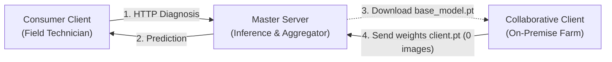

[English](README.en.md) | [Español](README.md)

# AgriFed-KHAOS: Federated Vision Framework for Agriculture

[](https://www.python.org/)
[](https://pytorch.org/)
[](https://flower.ai/)
[](https://github.com/astral-sh/ruff)
[](http://mypy-lang.org/)

AgriFed-KHAOS is a modular **Federated Learning** (FL) framework designed for computer vision workloads. It enables multiple institutions to collaboratively train and enhance visual diagnostic models without centralizing or sharing private field images.

---

## Table of Contents

- [Conceptual Overview](#conceptual-overview)
- [Specialized Documentation](#specialized-documentation)
- [Getting Started](#getting-started)
- [Streamlined Workflow](#streamlined-workflow)
- [Repository Structure](#repository-structure)
- [License](#license)

---

## Conceptual Overview

The system coordinates three decoupled roles:



### Role Legend:
* **Master Server:** Trains the initial base model, exposes the REST inference API (`POST /predict`), and aggregates incoming weights via parameter security gates.
* **Consumer Client:** Field technician or end-user classifying images. Makes lightweight HTTP calls to the API (via `curl` or mobile app). Requires neither cloning this repository nor installing PyTorch.
* **Collaborative Client:** Organization with private images participating in federated learning. Downloads the base weights, trains locally on its own host with a single command, and returns solely the resulting parameter file (`.pt`). **Zero images leave its private network.**

---

## Specialized Documentation

In-depth technical guides tailored to each profile:

| Document | Language | Core Focus |
| :--- | :---: | :--- |
| [**User Guide**](docs/user_guide.md) | Spanish / English | Step-by-step operational manual structured by the 3 system roles (Admin, Consumer, and On-Premise Collaborator) on any dataset. |
| [**System Architecture**](docs/architecture.md) | Spanish | Deep-dive engineering specification (Adapter pattern, security gates, HMAC lineage, formal DP, and FedAvgM). |
| [**Empirical Case Study**](docs/workflow.md) | Spanish | Real end-to-end 2-machine validation on the Khaos olive leaf pathology dataset with quantified $T_0 \rightarrow T_1$ metrics. |

---

## Getting Started

### Quickstart with Docker (Recommended)

```bash
# 1. Clone repository
git clone https://github.com/diegodepab/AgriFed-khaos.git
cd AgriFed-khaos

# 2. Launch container environment
cp .env.example .env
make up

# 3. Enter interactive container shell
docker compose exec agrifed bash
```

> **GPU Acceleration:** If NVIDIA GPUs are available, run: `docker compose -f compose.yaml -f compose.gpu.yaml up -d`.

---

## Streamlined Workflow

Following a lazy-user philosophy, each command relies on intelligent defaults so you only specify what is strictly necessary:

<details open>
<summary><strong>Step 1: Train Base Model (Master Server)</strong></summary>

Simply provide the folder containing your initial training images:

```bash
python scripts/train_base.py --data-dir my_dataset/train
```

*Automatically selects the best architecture (`auto`), resolves input resolution, and outputs `models/base_model.pt`.*

<details>
<summary>View optional customization flags</summary>

* `--arch {auto, resnet18, resnet50, mobilenetv4_conv_small}`: Explicitly choose model backbone.
* `--epochs <int>`: Number of training epochs (default: 3).
* `--batch-size <int>`: Batch size (default: 32).
* `--lr <float>`: Learning rate (default: 0.001).
* `--img-size <int>`: Input image resolution in pixels (default: 224).
</details>
</details>

<details open>
<summary><strong>Step 2: Serve Model as REST API (Master Server)</strong></summary>

Launches the HTTP microservice for consumer clients:

```bash
python scripts/serve.py
```

*Loads `models/global_model.pt` (or `base_model.pt`) and listens on port `8000` by default.*
</details>

<details open>
<summary><strong>Step 3: Diagnose a Field Image (Consumer Client)</strong></summary>

The technician needs neither PyTorch nor repository code. Classify any image with a standard HTTP request:

```bash
curl -X POST http://localhost:8000/predict -F "file=@sample.jpg"
```

*Returns predicted class, confidence score, and per-class probabilities.*
</details>

<details open>
<summary><strong>Step 4: Local Training & Fusion (Collaborator + Master)</strong></summary>

**On the collaborator's machine (100% private data):**
The partner only points to its private images folder:

```bash
python scripts/client_trainer.py --data-dir my_private_images/
```

*Outputs `models/client_parameters.pt` (~18 KB). The partner sends only this file to the administrator.*

**On the master server (secure aggregation):**
The administrator fuses incoming client weights:

```bash
python scripts/aggregate.py --client-weights models/client_1.pt models/client_2.pt
```

*Audits security gates, applies FedAvgM momentum, and updates `models/global_model.pt`.*
</details>

---

## Repository Structure

```text
AgriFed-khaos/
├── configs/                  # YAML configurations for Flower runtime
├── docs/                     # Specialized documentation (user guide, architecture, workflow)
├── models/                   # Local storage for model checkpoints (.pt) and metadata
├── scripts/                  # Direct CLI entrypoints
│   ├── train_base.py         # Base model trainer (Auto-FL)
│   ├── client_trainer.py     # On-premise client trainer (zero data leakage)
│   ├── aggregate.py          # Secure multi-client aggregator (FedAvgM + HMAC)
│   ├── serve.py              # FastAPI inference REST service (/predict)
│   └── evaluate.py           # Evaluation, calibration, and Grad-CAM
├── src/agrifed_khaos/        # Core modular framework package (SOLID)
├── tests/                    # Unit and integration test suite (45 tests)
├── compose.yaml              # Official Docker service definition
├── Makefile                  # Workflow automation (build, up, test, lint)
└── pyproject.toml            # Formal package manifest (PEP 621)
```

---

## License

Distributed under the Apache 2.0 License. See `LICENSE` for details.
