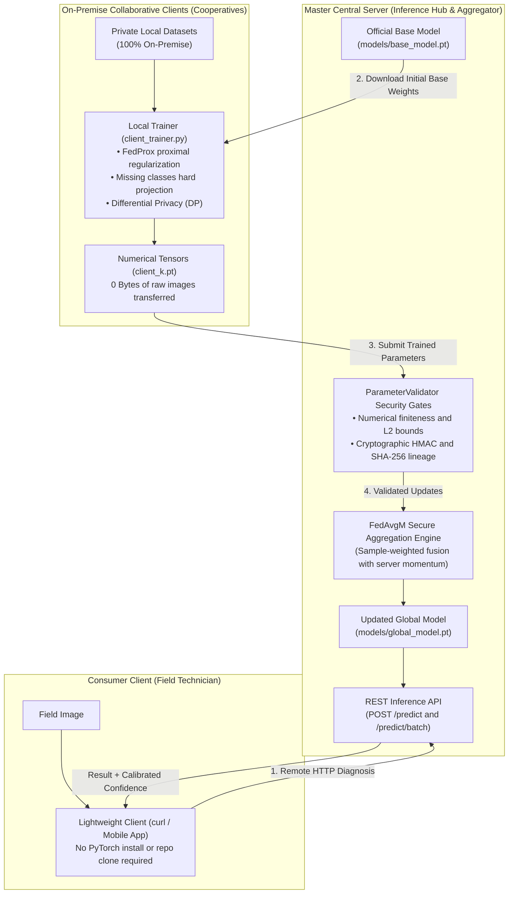

[English](README.en.md) | [Español](README.md)

# AgriFed-KHAOS: Federated Vision Framework for Agriculture

[](https://www.python.org/)
[](https://pytorch.org/)
[](https://flower.ai/)
[](https://github.com/astral-sh/ruff)
[](http://mypy-lang.org/)

AgriFed-KHAOS is a modular, decoupled **Federated Learning** (FL) framework designed for distributed Computer Vision workloads. It is built for agricultural and industrial environments where raw image data is strictly confidential and geographically distributed across edge clients, cooperatives, and farms.

---

## Table of Contents

- [Project Overview](#project-overview)
- [Conceptual System Architecture](#conceptual-system-architecture)
- [Specialized Documentation](#specialized-documentation)
- [Getting Started](#getting-started)
- [Streamlined 4-Step Workflow](#streamlined-4-step-workflow)
- [Repository Structure](#repository-structure)
- [Code Quality and Collaboration](#code-quality-and-collaboration)
- [License](#license)

---

## Project Overview

### What is it and what is it for?
AgriFed-KHAOS enables multiple institutions or agricultural producers to collaborate on training and improving state-of-the-art vision models **without ever sharing or centralizing their private field images**.

### Problems it solves:
1. **Data Leakage and Regulatory Compliance:** Raw image files never leave the local on-premise host (guaranteed zero data leakage, compliant with GDPR and trade secret regulations).
2. **Network Bandwidth Bottlenecks:** Eliminates the need to upload gigabytes of images to cloud servers; only lightweight numerical parameter tensors (~18 KB in classifier head mode) are transmitted over the network.
3. **Severe Non-IID Skew:** Employs advanced algorithms to mitigate client drift, protect missing classes, and support dynamic class expansion for unseen emerging diseases.

---

## Conceptual System Architecture

The framework coordinates three decoupled roles with clear boundaries:



---

## Specialized Documentation

The repository maintains dedicated technical documentation tailored to specific needs:

| Document | Purpose | Core Content |
| :--- | :--- | :--- |
| [**User Guide**](docs/user_guide.md) | Practical step-by-step manual | How to run the framework on **any image dataset** (`ImageFolder`), complete CLI commands for base training, on-premise training, aggregation, and REST API consumption. |
| [**Architecture Specification**](docs/architecture.md) | In-depth engineering and code | SOLID principles, Adapter pattern (`BaseFLWrapper`), security gates (`ParameterValidator`), HMAC signatures, CRC32 deterministic initialization, formal DP, and FedAvgM momentum. |
| [**Empirical Case Study**](docs/workflow.md) | Reference business workflow | End-to-end empirical validation on olive leaf pathology, quantified evolution ($T_0 \rightarrow T_1$), confusion matrices, and Grad-CAM explainability. |

---

## Getting Started

### Prerequisites
* Docker and Docker Compose (recommended for full environment reproducibility).
* Alternatively: Python 3.10+ on Linux/macOS/WSL.

### Quickstart with Docker

```bash
# 1. Clone the repository
git clone https://github.com/diegodepab/AgriFed-khaos.git
cd AgriFed-khaos

# 2. Configure environment variables
cp .env.example .env

# 3. Build and launch container
make build
make up

# 4. Access interactive container shell
docker compose exec agrifed bash
```

> **GPU Acceleration:** If NVIDIA GPUs and the NVIDIA Container Toolkit are available, run `docker compose -f compose.yaml -f compose.gpu.yaml up -d`.

---

## Streamlined 4-Step Workflow

The complete lifecycle requires human intervention only at 4 essential moments:

<details>
<summary><strong>Step 1: Train the Official Base Model (Central Server)</strong></summary>

The central server trains a baseline reference checkpoint, automatically selecting the optimal architecture based on client edge hardware and dataset dimensions:

```bash
python scripts/train_base.py \
  --data-dir /path/to/dataset/train \
  --arch auto \
  --target-client-tier cpu-low \
  --output models/base_model.pt
```

*Generates a self-contained `.pt` bundle packaging weights (`state_dict`), discovered classes, input resolution, and metadata.*
</details>

<details>
<summary><strong>Step 2: Serve the Model via REST API (Inference & Diagnosis)</strong></summary>

Exposes the model via an HTTP REST microservice for remote clients and field applications without requiring PyTorch installations:

```bash
python scripts/serve.py \
  --model models/base_model.pt \
  --host 0.0.0.0 \
  --port 8000
```

*Consuming via `curl`:*
```bash
curl -X POST http://localhost:8000/predict -F "file=@field_sample.jpg"
```
</details>

<details>
<summary><strong>Step 3: On-Premise Local Training (Collaborative Clients)</strong></summary>

Each participating cooperative trains on its private images. Zero image bytes leave their premises:

```bash
python scripts/client_trainer.py \
  --data-dir /path/to/private_data \
  --weights-in models/base_model.pt \
  --weights-out models/client_1.pt \
  --head-only \
  --allow-new-classes \
  --client-id coop_sevilla
```

*Enforces canonical class remapping, missing class hard projection, and optional formal Differential Privacy (`--dp-clip-norm 1.0 --dp-noise-std 0.01`).*
</details>

<details>
<summary><strong>Step 4: Security Audit & Federated Aggregation (Central Server)</strong></summary>

The server receives numerical parameter updates, audits them against divergence/anomalies, and merges them with FedAvgM server momentum:

```bash
python scripts/aggregate.py \
  --base-model models/base_model.pt \
  --client-weights models/client_1.pt models/client_2.pt \
  --output models/global_model.pt \
  --allow-new-classes \
  --server-momentum 0.9 \
  --skip-invalid-clients
```

*Produces the updated global bundle `models/global_model.pt`, which the REST service reloads automatically.*
</details>

---

## Repository Structure

```text
AgriFed-khaos/
├── configs/                  # YAML configurations for centralized Flower runtime
├── docs/                     # Specialized documentation (user guide, architecture, case study)
├── models/                   # Local storage for model checkpoints (.pt) and auditable metadata
├── scripts/                  # Direct CLI entrypoints
│   ├── train_base.py         # Base model trainer (Auto-FL)
│   ├── client_trainer.py     # On-premise client trainer (zero data leakage)
│   ├── aggregate.py          # Multi-client secure aggregator (FedAvgM + HMAC + Gate)
│   ├── evaluate.py           # Evaluation, One-vs-Rest calibration, and Grad-CAM
│   └── serve.py              # FastAPI inference microservice (/predict)
├── src/agrifed_khaos/        # Core source package
│   ├── crypto.py             # Cryptographic utilities (SHA-256 and HMAC-SHA256)
│   ├── data.py               # Dirichlet partitioning, stratified sampling, and loaders
│   ├── federated.py          # SanitizedFedProx strategy and Flower client adapter
│   ├── hardware.py           # Auto-FL ModelSelector auditing hardware & data constraints
│   ├── models.py             # Backbone model factory & self-contained checkpoint bundles
│   ├── quality.py            # Multiclass One-vs-Rest calibration and regression guardrail
│   └── wrappers.py           # Model adapters (BaseFLWrapper, TorchModuleWrapper)
├── tests/                    # Comprehensive 45-test unit and integration test suite
├── compose.yaml              # Docker service definition
├── Makefile                  # Developer workflow automation (build, up, test, lint)
└── pyproject.toml            # Formal PEP 621 packaging and dependency manifest
```

---

## Code Quality and Collaboration

The project enforces a strict zero-error, zero-warning quality policy:

* **Run Test Suite (45 tests):**
  ```bash
  make test
  # Equivalent to: docker compose exec agrifed pytest
  ```
* **Static Analysis & Strict Typing:**
  ```bash
  make lint
  # Runs ruff check and mypy with zero error tolerance
  ```

---

## License

Distributed under the Apache 2.0 License. See `LICENSE` for more information.

