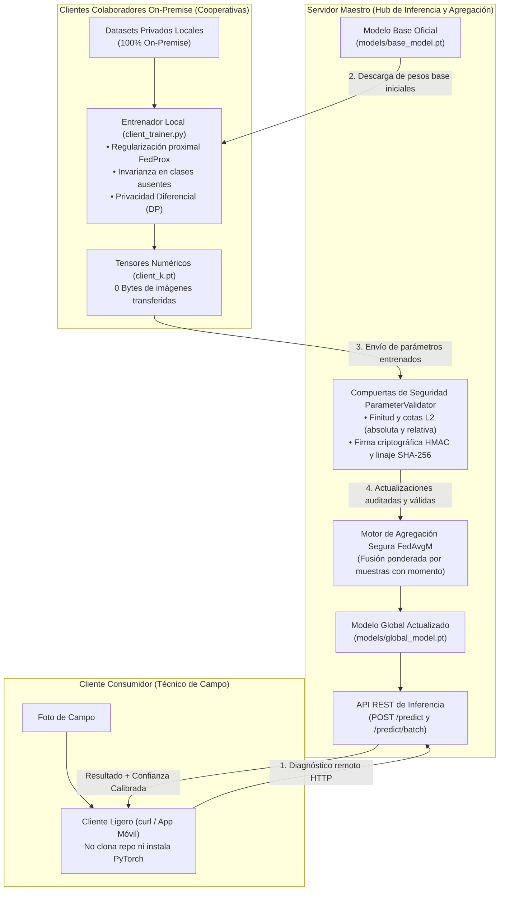

[Español](README.md) | [English](README.en.md)

# AgriFed-KHAOS: Framework Federado de Visión Artificial para Agricultura

[](https://www.python.org/)
[](https://pytorch.org/)
[](https://flower.ai/)
[](https://github.com/astral-sh/ruff)
[](http://mypy-lang.org/)

AgriFed-KHAOS es un framework modular y desacoplado de **Aprendizaje Federado** (*Federated Learning*, FL) orientado a Visión por Computador. Diseñado para operar en entornos agrícolas e industriales donde los datos son altamente confidenciales y se encuentran distribuidos entre diferentes sedes o cooperativas.

---

## Tabla de Contenidos

- [Descripción del Proyecto](#descripción-del-proyecto)
- [Esquema Conceptual del Sistema](#esquema-conceptual-del-sistema)
- [Documentación Especializada](#documentación-especializada)
- [Inicio Rápido](#inicio-rápido)
- [Flujo Operativo en 4 Pasos](#flujo-operativo-en-4-pasos)
- [Estructura del Repositorio](#estructura-del-repositorio)
- [Calidad de Código y Colaboración](#calidad-de-código-y-colaboración)
- [Licencia](#licencia)

---

## Descripción del Proyecto

### ¿Qué es y para qué sirve?
AgriFed-KHAOS permite que múltiples organizaciones o productores colaboren para entrenar y mejorar modelos de visión artificial de alta precisión **sin necesidad de compartir ni centralizar sus imágenes privadas**.

### Problemas que resuelve:
1. **Fuga de Datos y Cumplimiento Normativo:** Los datos visuales en bruto jamás abandonan las instalaciones locales del cliente (garantía de cero fuga de datos, compatible con RGPD y secretos comerciales).
2. **Cuellos de Botella de Ancho de Banda:** Elimina la necesidad de transferir gigabytes de imágenes a servidores en la nube; únicamente se transmiten ligeros tensores de pesos numéricos (~18 KB en modo clasificador).
3. **Distribuciones No-IID Extremas:** Incorpora algoritmos avanzados para mitigar el desvío del cliente (*client drift*), gestionar clases ausentes y permitir la expansión dinámica de nuevas patologías no vistas en el modelo base.

---

## Esquema Conceptual del Sistema

El sistema coordina tres roles bien diferenciados sin dependencias circulares:



---

## Documentación Especializada

El proyecto cuenta con guías técnicas detalladas según el perfil de uso:

| Documento | Propósito | Contenido Principal |
| :--- | :--- | :--- |
| [**Manual de Usuario**](docs/user_guide.md) | Guía práctica paso a paso | Cómo usar el framework con **cualquier dataset de imágenes** (`ImageFolder`), comandos CLI para entrenamiento base, cliente on-premise, agregación y consumo de la API REST. |
| [**Arquitectura del Sistema**](docs/architecture.md) | Especificación técnica y código | Principios SOLID, patrón Adaptador (`BaseFLWrapper`), compuertas de seguridad (`ParameterValidator`), linaje HMAC, inicialización determinista CRC32, DP formal y servidor FedAvgM. |
| [**Caso de Estudio Empírico**](docs/workflow.md) | Caso de negocio de referencia | Validación empírica real de extremo a extremo sobre patología foliar, evolución cuantificada ($T_0 \rightarrow T_1$), matrices de confusión y explicabilidad Grad-CAM. |

---

## Inicio Rápido

### Requisitos Previos
* Docker y Docker Compose (recomendado para máxima reproducibilidad).
* O alternativamente: Python 3.10+ y entorno virtual Linux/macOS/WSL.

### Puesta en Marcha con Docker

```bash
# 1. Clonar el repositorio
git clone https://github.com/diegodepab/AgriFed-khaos.git
cd AgriFed-khaos

# 2. Configurar variables de entorno
cp .env.example .env

# 3. Construir e iniciar el contenedor
make build
make up

# 4. Acceder al shell interactivo dentro del contenedor
docker compose exec agrifed bash
```

> **Soporte GPU:** Si dispone de GPUs NVIDIA y el NVIDIA Container Toolkit, ejecute `docker compose -f compose.yaml -f compose.gpu.yaml up -d`.

---

## Flujo Operativo en 4 Pasos

El ciclo completo requiere intervención únicamente en 4 puntos clave:

<details>
<summary><strong>Paso 1: Entrenar el Modelo Base Oficial (Servidor Maestro)</strong></summary>

El servidor central entrena una primera versión de referencia seleccionando automáticamente la arquitectura adecuada según el perfil de hardware de los clientes y las dimensiones del dataset:

```bash
python scripts/train_base.py \
  --data-dir /ruta/al/dataset/train \
  --arch auto \
  --target-client-tier cpu-low \
  --output models/base_model.pt
```

*Genera un checkpoint `.pt` autocontenido con los pesos (`state_dict`), clases descubiertas, resolución y metadatos.*
</details>

<details>
<summary><strong>Paso 2: Servir el Modelo como API REST (Inferencia y Diagnóstico)</strong></summary>

Expone el modelo mediante una API REST HTTP para que clientes externos o aplicaciones de campo clasifiquen imágenes sin instalar PyTorch:

```bash
python scripts/serve.py \
  --model models/base_model.pt \
  --host 0.0.0.0 \
  --port 8000
```

*Consumo con `curl`:*
```bash
curl -X POST http://localhost:8000/predict -F "file=@foto_campo.jpg"
```
</details>

<details>
<summary><strong>Paso 3: Entrenamiento Local On-Premise (Clientes Colaboradores)</strong></summary>

Cada cooperativa colaboradora entrena sobre sus imágenes privadas. Cero bytes de imágenes abandonan su host:

```bash
python scripts/client_trainer.py \
  --data-dir /ruta/a/datos_privados \
  --weights-in models/base_model.pt \
  --weights-out models/client_1.pt \
  --head-only \
  --allow-new-classes \
  --client-id coop_sevilla
```

*Aplica remapeo canónico de clases, protección contra clases ausentes, y opcionalmente Privacidad Diferencial formal (`--dp-clip-norm 1.0 --dp-noise-std 0.01`).*
</details>

<details>
<summary><strong>Paso 4: Auditoría de Seguridad y Agregación Federada (Servidor Maestro)</strong></summary>

El servidor recibe las actualizaciones numéricas de los clientes, las audita contra anomalías y las fusiona con momento FedAvgM:

```bash
python scripts/aggregate.py \
  --base-model models/base_model.pt \
  --client-weights models/client_1.pt models/client_2.pt \
  --output models/global_model.pt \
  --allow-new-classes \
  --server-momentum 0.9 \
  --skip-invalid-clients
```

*Produce el modelo global actualizado `models/global_model.pt`, que la API REST recarga inmediatamente.*
</details>

---

## Estructura del Repositorio

```text
AgriFed-khaos/
├── configs/                  # Configuraciones YAML para ejecución Flower centralizada
├── docs/                     # Documentación especializada (usuario, arquitectura, caso de estudio)
├── models/                   # Directorio local de checkpoints (.pt) y metadatos auditables
├── scripts/                  # Puntos de entrada CLI directos
│   ├── train_base.py         # Entrenamiento del modelo base (Auto-FL)
│   ├── client_trainer.py     # Entrenamiento local on-premise (cero fuga de datos)
│   ├── aggregate.py          # Agregador seguro multi-cliente (FedAvgM + HMAC + Gate)
│   ├── evaluate.py           # Evaluación, calibración One-vs-Rest y Grad-CAM
│   └── serve.py              # Microservicio de inferencia FastAPI (/predict)
├── src/agrifed_khaos/        # Paquete fuente principal
│   ├── crypto.py             # Funciones criptográficas seguras (SHA-256 y HMAC)
│   ├── data.py               # Particionado Dirichlet, muestreo estratificado y loaders
│   ├── federated.py          # Estrategia SanitizedFedProx y cliente Flower
│   ├── hardware.py           # Auto-FL ModelSelector según hardware y datos
│   ├── models.py             # Factoría de arquitecturas y checkpoints autocontenidos
│   ├── quality.py            # Calibración multiclase One-vs-Rest y guardrails
│   └── wrappers.py           # Adaptadores de modelos (BaseFLWrapper, TorchModuleWrapper)
├── tests/                    # Suite de 45 pruebas unitarias y de integración
├── compose.yaml              # Definición de contenedor Docker
├── Makefile                  # Comandos de automatización (build, up, test, lint)
└── pyproject.toml            # Definición formal de empaquetado (PEP 621)
```

---

## Calidad de Código y Colaboración

El proyecto se adhiere a un estándar estricto de cero errores y cero advertencias:

* **Ejecutar Suite de Pruebas (45 tests):**
  ```bash
  make test
  # Equivalente a: docker compose exec agrifed pytest
  ```
* **Análisis Estático y Tipado Estricto:**
  ```bash
  make lint
  # Ejecuta ruff check y mypy con política 0 errores
  ```

---

## Licencia

Distribuido bajo la Licencia Apache 2.0. Consulte `LICENSE` para más detalles.
