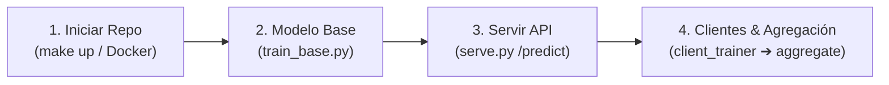
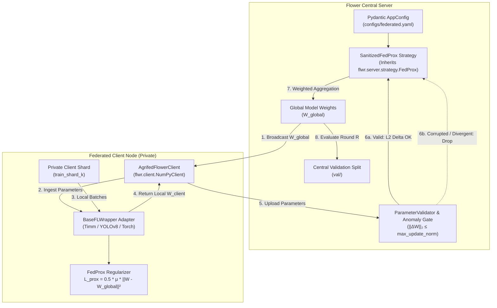

# AgriFed-KHAOS: Federated Vision Framework for Agriculture

[](https://www.python.org/)
[](https://pytorch.org/)
[](https://flower.ai/)
[](https://github.com/astral-sh/ruff)
[](http://mypy-lang.org/)

**AgriFed-KHAOS** is a modular Federated Learning (FL) framework designed for distributed Computer Vision workloads in agriculture. Operating in tandem with **agrivision-khaos** (which handles upstream Data-Centric AI curation, preprocessing, and normalization), AgriFed-khaos assumes local datasets are Gold Standard and focuses entirely on distributed orchestration, heterogeneous model training, and robust parameter aggregation under severe Non-IID conditions.

---

## 🚀 Flujo Operativo Esencial en 4 Pasos (Para Directores y Nuevos Usuarios)

El ciclo de vida completo de AgriFed-KHAOS está diseñado para operar con la mínima intervención técnica en 4 fases intuitivas:



1. **Iniciar Entorno (Docker Reproducible):**
   ```bash
   cp .env.example .env && make up
   ```
2. **Subir un Dataset y Entrenar Modelo Base:**
   Sube cualquier dataset en formato `ImageFolder` (ej. `/data/mi_cultivo/train`) y genera el checkpoint bundle inicial:
   ```bash
   python scripts/train_base.py --data-dir /data/mi_cultivo/train --output models/base_model.pt
   ```
3. **Servir el Modelo para Diagnóstico Remoto (REST API):**
   Levanta el microservicio de inferencia con calibración automática y resolución dinámica:
   ```bash
   python scripts/serve.py --model models/base_model.pt --host 0.0.0.0 --port 8000
   ```
4. **Entrenar en Clientes Periféricos y Agregar Parámetros Federados:**
   El cliente entrena localmente sin enviar una sola imagen (garantía de cero fuga de datos):
   ```bash
   # En el cliente perimetral (cooperativa / granja):
   python scripts/client_trainer.py --data-dir /data/privado --weights-in models/base_model.pt --weights-out models/client_1.pt --head-only

   # En el servidor central (fusión de parámetros con FedAvgM y compuertas de seguridad):
   python scripts/aggregate.py --base-model models/base_model.pt --client-weights models/client_1.pt --output models/global_model.pt
   ```

---

## 📚 Documentación del Proyecto

El repositorio cuenta con una jerarquía de documentación especializada:

1. [**`docs/architecture.md`**](docs/architecture.md) — **Arquitectura y Especificación Técnica v1.0:**
   - Principios SOLID, checkpoints autocontenidos `.pt` y linaje HMAC.
   - Proyección dura de clases ausentes, expansión dinámica con init determinista CRC32.
   - Privacidad Diferencial formal ($L_2$ clip + Gaussian noise) y servidor FedAvgM.
2. [**`docs/user_guide.md`**](docs/user_guide.md) — **Manual Operativo Paso a Paso (Agnóstico de Dominio):**
   - Cómo operar con cualquier dataset (frutas, hojas, anomalías).
   - Comandos directos para Auto-FL, inferencia calibrada, clientes on-premise y agregación segura.
3. [**`docs/workflow.md`**](docs/workflow.md) — **Caso de Estudio Empírico de Referencia:**
   - Validación empírica real de extremo a extremo sobre patología foliar (*Olea europaea*).
   - Matrices de confusión, curvas de calibración y mapas de atención Grad-CAM.

---

## 1. System Architecture

AgriFed-KHAOS decouples vision architectures from the federated runtime through the **Adapter Pattern** and enforces parameter security via a **Sanitized FedProx Strategy**.



---

## 2. Core Architectural Pillars

### A. Model Adapter Pattern (`BaseFLWrapper`)
Flower communicates through serialized lists of NumPy arrays (`list[np.ndarray]`). Deep learning frameworks (Ultralytics, Timm, PyTorch) represent weights as internal module parameters and state dictionaries.
* [`BaseFLWrapper`](src/agrifed_khaos/wrappers.py): Abstract base class defining `get_parameters()`, `set_parameters()`, `train_local_epoch()`, and `evaluate()`.
* [`TimmClassificationWrapper`](src/agrifed_khaos/wrappers.py): Specialized adapter for Vision Transformers (ViT) and CNNs built via `timm`.
* [`YOLOv8Wrapper`](src/agrifed_khaos/wrappers.py): Specialized adapter for Ultralytics YOLOv8+ object detection models.
* [`TorchModuleWrapper`](src/agrifed_khaos/wrappers.py): Generic PyTorch module adapter that isolates trainable parameters (`requires_grad`) from BatchNorm buffers, preventing runtime crashes in proximal loss calculations.

### B. Sanitized FedProx & Parameter Gating
In federated agricultural networks, clients may suffer from noisy updates, unstable local learning rates, or data poisoning.
* [`ParameterValidator`](src/agrifed_khaos/wrappers.py):
  1. **Structural Check:** Verifies exact tensor count, dimensions, and data types match the global model.
  2. **Numerical Finiteness:** Enforces that all values are finite (zero tolerance for `NaN` or `Inf`).
  3. **Divergence Norm ($\Delta W$):** Calculates the L2 distance of the parameter update:
     $$\Delta W = \| W_{client} - W_{global} \|_2 = \sqrt{\sum_{i} \| w_i^{client} - w_i^{global} \|_F^2}$$
     If $\Delta W > \Delta_{max}$ (`max_update_norm`), the update is flagged as an anomaly.
* [`SanitizedFedProx`](src/agrifed_khaos/federated.py): Subclasses Flower's native `FedProx`. Intercepts `aggregate_fit` and excludes non-compliant clients before delegating to weighted parameter averaging.

### C. Zero-Leakage Data Contract
> [!IMPORTANT]
> The global `test` split must **NEVER** be used as a client training source.
> Using `test` for local training contaminates the global model and invalidates out-of-distribution evaluation.

The canonical partition contract:
* **`dataset/train`**: Sharded deterministically across federated clients via SHA-256 hashing.
* **`dataset/val`**: Reserved for the central server to evaluate Round 0 baseline quality and round-by-round convergence.
* **`dataset/test`**: Untouched, pristine holdout split for final global benchmark evaluation.

### D. Self-Contained Checkpoint Bundles (`.pt`)
Todos los checkpoints guardan y cargan de forma autocontenida la tupla:
`{"state_dict": ..., "metadata": {"architecture": ..., "num_classes": ..., "classes": ..., "img_size": ..., "calibrated_thresholds": ...}}`.
Esto garantiza que `serve.py` o `client_trainer.py` levanten el modelo de forma inmediata sin archivos de metadatos externos obligatorios ni hardcoding de resolución o clases.

### E. Missing Classes Masking & Hard Projection
Cuando un cliente local solo contiene un subconjunto de clases (Non-IID extremo):
1. **Remapeo Canónico:** Reordena los índices locales de `ImageFolder` contra la lista nominal canónica `metadata["classes"]`.
2. **Proyección Dura Post-Step:** Restaura exactamente los pesos y sesgos de las clases ausentes tras cada paso del optimizador (`p.data[missing_idx] = base_p[missing_idx]`), previniendo distorsiones por momento o decaimiento de pesos.

### F. Dynamic Federated Class Expansion (`--allow-new-classes`)
Soporta clientes que incorporan nuevas clases en producción:
* **Inicialización Determinista CRC32:** Tanto el cliente como el servidor inicializan las filas de las clases no vistas con una semilla derivada de `CRC32(class_name)`, garantizando que el punto de partida sea idéntico y no contamine la norma $\Delta W$.
* **Alineación Nominal:** En el servidor (`aggregate.py`), las matrices de pesos se fusionan alineando por nombre de clase, no por posición.

### G. Formal Differential Privacy & FedAvgM
* **Mecanismo Gaussiano Global ($L_2$):** `--dp-clip-norm` recorta el vector global concatenado de pesos entrenables y `--dp-noise-std` inyecta ruido normal $\mathcal{N}(0, \sigma^2 \cdot C^2)$, eximiendo explícitamente los buffers de BatchNorm.
* **FedAvgM (Server Momentum):** Aceleración de agregación global con momento $\beta$ (`--server-momentum 0.9` por defecto) para estabilizar la convergencia bajo clientes heterogéneos.

---

## 3. Quickstart & Operational Commands

The project is designed to run via Docker to ensure environment parity across Linux and WSL hosts.

### 1. Build and Launch Container
```bash
cp .env.example .env
make build
make up
```

### 2. Run Data Leakage Audit
Mathematically verifies image counts and confirms zero split overlap:
```bash
python3 scripts/audit_data_leakage.py /data/EnfermedadesHoja_v1.0
```

### 3. Run Dataset & Config Audit
```bash
make audit
# Or via CLI directly:
python -m agrifed_khaos.cli --config configs/federated.yaml
```

### 4. Run Test Suite
```bash
make test
```

### 5. Static Analysis & Type Checking (Strict 0-Error Policy)
```bash
make lint
# Equivalent to:
# ruff check src tests
# mypy src tests
```

---

## 4. Configuration Schema

All hyperparameters are injected via YAML and validated at runtime using **Pydantic V2** and **pydantic-settings**:

```yaml
dataset:
  root: /data/EnfermedadesHoja_v1.0
  allow_test_as_client: false
  num_clients: 2
  client_split_seed: 42

model:
  family: torch             # torch | timm | ultralytics
  name: resnet18
  num_classes: 9
  pretrained: false
  device: cpu              # cpu | cuda
  img_size: 224

parameter_gate:
  max_update_norm: 100.0   # Maximum L2 norm tolerance
  enforce_finite: true     # Drop NaNs / Infs
  enforce_structural_match: true
  reject_anomalies: true

federation:
  rounds: 10
  min_clients: 2
  min_fit_clients: 2
  min_evaluate_clients: 2
  local_epochs: 1
  batch_size: 16
  learning_rate: 0.001
  prox_mu: 0.01            # FedProx proximal weight
  seed: 42

quality:
  min_baseline_accuracy: 0.0
  max_baseline_loss: 50.0
  run_pre_fl_baseline: true
  evaluate_global_every_round: true
```

Environment variables prefixed with `AGRIFED_` override any YAML setting (e.g., `AGRIFED_FEDERATION__PROX_MU=0.05`).

---

## 5. Repository Structure

```text
AgriFed-khaos/
├── configs/
│   ├── federated.yaml        # Default container-mounted configuration
│   └── local.yaml            # Host direct development configuration
├── scripts/
│   └── audit_data_leakage.py # Mathematical split isolation verifier
├── src/
│   └── agrifed_khaos/
│       ├── __init__.py       # Package exports
│       ├── cli.py            # CLI entrypoint for dataset audit
│       ├── config.py         # Pydantic configuration models
│       ├── data.py           # Sharding & DataLoader utilities
│       ├── federated.py      # Flower client, SanitizedFedProx & server hooks
│       ├── py.typed          # PEP 561 typing marker
│       ├── quality.py        # Baseline evaluation & split integrity
│       └── wrappers.py       # Model wrappers & parameter validator
├── tests/
│   ├── test_config.py        # Configuration validation tests
│   ├── test_dry_run.py       # YOLOv8 & SanitizedFedProx integration dry-run
│   ├── test_federated.py     # Parameter gate & metric aggregation tests
│   └── test_wrappers.py      # Torch wrapper & FedProx proximal loss tests
├── compose.yaml              # Docker compose service definition
├── compose.gpu.yaml          # NVIDIA GPU acceleration overlay
├── Dockerfile                # Production-grade Python 3.11 image
├── Makefile                  # Developer workflow automation
└── pyproject.toml            # PEP 621 packaging & tooling config
```
