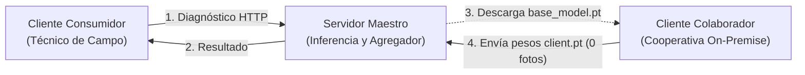

[Español](README.md) | [English](README.en.md)

# AgriFed-KHAOS: Framework Federado de Visión Artificial para Agricultura

[](https://www.python.org/)
[](https://pytorch.org/)
[](https://flower.ai/)
[](https://github.com/astral-sh/ruff)
[](http://mypy-lang.org/)

AgriFed-KHAOS es un framework modular de **Aprendizaje Federado** (*Federated Learning*, FL) para visión artificial. Permite entrenar y mejorar modelos de diagnóstico visual de forma colaborativa entre múltiples entidades sin necesidad de centralizar ni compartir imágenes privadas.

---

## Tabla de Contenidos

- [Esquema Conceptual](#esquema-conceptual)
- [Documentación Especializada](#documentación-especializada)
- [Inicio Rápido](#inicio-rápido)
- [Flujo Operativo Esencial](#flujo-operativo-esencial)
- [Estructura del Proyecto](#estructura-del-proyecto)
- [Licencia](#licencia)

---

## Esquema Conceptual

El sistema coordina tres roles independientes:



### Leyenda de Roles:
* **Servidor Maestro:** Entrena el modelo base inicial, expone la API REST de inferencia (`POST /predict`), y fusiona los pesos recibidos mediante compuertas de seguridad.
* **Cliente Consumidor:** Usuario o técnico de campo que solo quiere clasificar fotos. Realiza consultas HTTP sencillas a la API (vía `curl` o app móvil). No necesita clonar el repositorio ni instalar PyTorch.
* **Cliente Colaborador:** Organización con fotos privadas que ayuda a entrenar el modelo. Descarga los pesos base, entrena localmente en su propia máquina con un único comando, y envía únicamente el archivo de parámetros resultante (`.pt`). **Ninguna imagen sale de sus instalaciones.**

---

## Documentación Especializada

Guías detalladas según el perfil y objetivo:

| Documento | Idioma | Propósito Principal |
| :--- | :---: | :--- |
| [**Manual de Usuario**](docs/user_guide.md) | Español | Guía paso a paso dividida por los 3 roles (Administrador, Consumidor y Colaborador On-Premise) para usar cualquier dataset. |
| [**User Guide (EN)**](docs/user_guide.md) | English | Complete operational manual for all three system roles on any custom vision dataset. *(Próximamente / Available in Spanish)* |
| [**Arquitectura del Sistema**](docs/architecture.md) | Español | Especificación técnica en profundidad (patrón Adaptador, compuertas de seguridad, linaje HMAC, DP y FedAvgM). |
| [**Caso de Estudio Empírico**](docs/workflow.md) | Español | Validación real de extremo a extremo en 2 máquinas sobre el dataset de patología foliar del olivar, con métricas $T_0 \rightarrow T_1$. |

---

## Inicio Rápido

### Puesta en Marcha con Docker (Recomendado)

```bash
# 1. Clonar el repositorio
git clone https://github.com/diegodepab/AgriFed-khaos.git
cd AgriFed-khaos

# 2. Iniciar el entorno
cp .env.example .env
make up

# 3. Entrar al contenedor
docker compose exec agrifed bash
```

> **Aceleración GPU:** Si dispone de GPU NVIDIA, ejecute: `docker compose -f compose.yaml -f compose.gpu.yaml up -d`.

---

## Flujo Operativo Esencial

Siguiendo la filosofía de máxima simplicidad, cada paso cuenta con valores por defecto inteligentes para que solo deba indicar los datos imprescindibles:

<details open>
<summary><strong>Paso 1: Entrenar el Modelo Base (Servidor Maestro)</strong></summary>

Solo debe indicar la carpeta donde están las imágenes del entrenamiento inicial:

```bash
python scripts/train_base.py --data-dir mi_dataset/train
```

*Por defecto selecciona automáticamente la mejor arquitectura (`auto`), la resolución y guarda `models/base_model.pt`.*

<details>
<summary>Ver banderas de personalización opcionales</summary>

* `--arch {auto, resnet18, resnet50, mobilenetv4_conv_small}`: Fuerza una arquitectura concreta en lugar de elección automática.
* `--epochs <int>`: Número de épocas de entrenamiento (defecto: 3).
* `--batch-size <int>`: Tamaño del lote (defecto: 32).
* `--lr <float>`: Tasa de aprendizaje (defecto: 0.001).
* `--img-size <int>`: Resolución de imagen en píxeles (defecto: 224).
</details>
</details>

<details open>
<summary><strong>Paso 2: Servir el Modelo como API REST (Servidor Maestro)</strong></summary>

Levanta el microservicio HTTP para atender a los clientes consumidores:

```bash
python scripts/serve.py
```

*Por defecto carga `models/global_model.pt` (o `base_model.pt`) y escucha en el puerto `8000`.*
</details>

<details open>
<summary><strong>Paso 3: Diagnosticar una Foto (Cliente Consumidor)</strong></summary>

El técnico de campo no necesita PyTorch ni clonar este repositorio. Clasifica cualquier imagen con una petición HTTP:

```bash
curl -X POST http://localhost:8000/predict -F "file=@mi_foto.jpg"
```

*Devuelve la clase predicha, el porcentaje de confianza y las probabilidades por clase.*
</details>

<details open>
<summary><strong>Paso 4: Entrenar en Local y Fusionar (Cliente Colaborador + Maestro)</strong></summary>

**En la máquina de la cooperativa (datos 100% privados):**
El colaborador solo indica dónde tiene sus fotos locales:

```bash
python scripts/client_trainer.py --data-dir mis_fotos_privadas/
```

*Genera `models/client_parameters.pt` (~18 KB). El colaborador envía únicamente este archivo al administrador.*

**En el servidor maestro (agregación segura):**
El administrador fusiona los parámetros recibidos:

```bash
python scripts/aggregate.py --client-weights models/coop1.pt models/coop2.pt
```

*Audita las compuertas de seguridad, aplica momento FedAvgM y actualiza `models/global_model.pt`.*
</details>

---

## Estructura del Proyecto

```text
AgriFed-khaos/
├── configs/                  # Configuraciones YAML para ejecución Flower
├── docs/                     # Documentación especializada (usuario, arquitectura, workflow)
├── models/                   # Almacén de checkpoints (.pt) y metadatos
├── scripts/                  # Puntos de entrada CLI directos
│   ├── train_base.py         # Entrenador del modelo base (Auto-FL)
│   ├── client_trainer.py     # Entrenador local del cliente (cero fuga de datos)
│   ├── aggregate.py          # Agregador multi-cliente seguro (FedAvgM + HMAC)
│   ├── serve.py              # API REST de inferencia FastAPI (/predict)
│   └── evaluate.py           # Evaluación, calibración y Grad-CAM
├── src/agrifed_khaos/        # Núcleo modular del framework (SOLID)
├── tests/                    # Suite de pruebas unitarias y de integración (45 tests)
├── compose.yaml              # Servicio Docker oficial
├── Makefile                  # Automatización de tareas (build, up, test, lint)
└── pyproject.toml            # Definición formal del paquete (PEP 621)
```

---

## Licencia

Distribuido bajo la Licencia Apache 2.0. Consulte `LICENSE` para más información.
