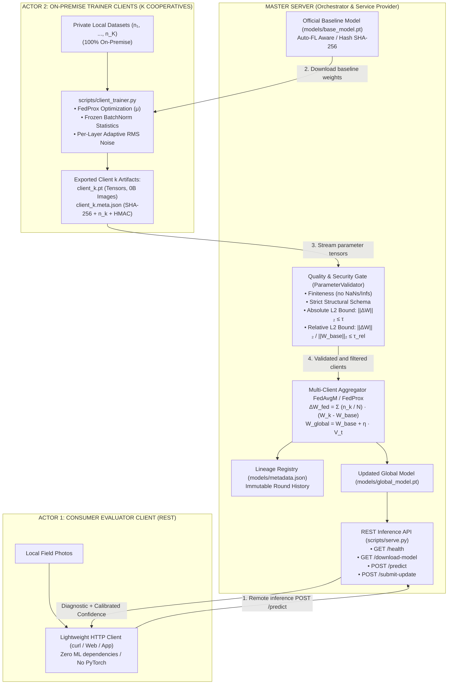
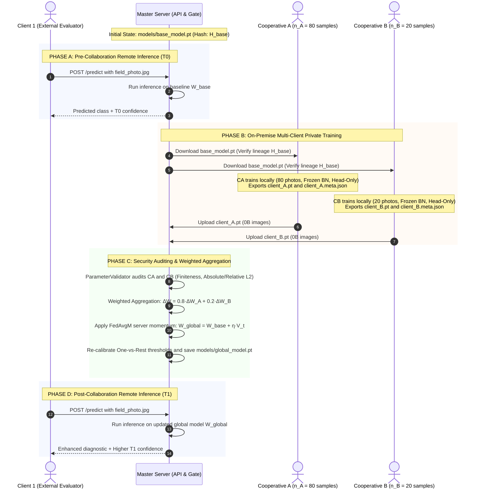

# System Architecture: AgriFed-KHAOS

> English documentation. Versión en español disponible en [docs/architecture.md](architecture.md).

Technical specification and architectural design document for **AgriFed-KHAOS**, a modular Federated Learning (FL) framework optimized for distributed Computer Vision workloads.

---

## 1. Design Principles & SOLID Standards

The framework is architected according to modern software engineering and MLOps principles:

1. **Domain-Agnostic Core:** The framework engine does not hardcode nor depend on any specific crop, botanical species, or visual pathology. It operates over arbitrary image tensors arranged in standard class directories (`ImageFolder`) or annotated dataset manifests.
2. **Data-Centric Decoupling (Dependency Inversion Principle - DIP):** Dataset curation, quality filtering, and standard normalization are managed exclusively by upstream data engines like [`agrivision-khaos`](https://github.com/Diegodepab/agrivision-khaos). `AgriFed-KHAOS` assumes edge datasets are Gold Standard and focuses entirely on distributed optimization and robust parameter aggregation.
3. **Adapter Pattern (Open/Closed Principle - OCP):** The [`BaseFLWrapper`](../src/agrifed_khaos/wrappers.py) abstraction decouples the federated transport runtime (Flower / NumPy arrays) from underlying deep learning backbones (PyTorch, Timm, Ultralytics YOLO).
4. **Zero Data Leakage Contract:** Raw physical data (RGB images and local labels) strictly never leave the client's perimeter host. The network exclusively exchanges numerical parameter updates and cryptographic signatures.

---

## 2. System Topology & Multi-Client Architecture



---

## 3. Key Architectural Components

### A. Auto-FL Model Selector (`ModelSelector`)

Located in [`src/agrifed_khaos/hardware.py`](../src/agrifed_khaos/hardware.py), `ModelSelector` resolves the initial baseline architecture based on hardware constraints:

* **Hardware Probing:** Inspects CPU cores, available RAM, and CUDA VRAM.
* **Tier Assignment:**
  - `cpu-low`: Constrained edge devices $\rightarrow$ `mobilenetv4_conv_small` / `resnet18`.
  - `cpu-high`: Multi-core compute servers $\rightarrow$ `resnet50`.
  - `gpu`: Dedicated GPU workstations $\rightarrow$ `convnext_tiny`.
* **Heuristic Sample Capping:** Imposes balanced limits (e.g., `--max-samples 1800`) to guarantee fast convergence on CPU without thermal throttling.

---

### B. BatchNorm Freezing on Edge Clients (`freeze_batchnorm_layers`)

In federated vision setups with extreme Non-IID skew across cooperatives:

* **Running Statistics Freezing:** During local client fine-tuning, all `nn.BatchNorm2d` layers have `.eval()` locked. `running_mean` and `running_var` are frozen to preserve general spatial representations learned on the baseline model.
* **Affine Parameter Adaptability:** Trainable affine weights (`bn.weight`, `bn.bias` with `requires_grad=True`) adapt normally during optimization.
* **Server Invariance:** The aggregation script [`scripts/aggregate.py`](../scripts/aggregate.py) preserves the baseline normalization buffers bit-by-bit in `models/global_model.pt`.

---

### C. FedProx Regularization and Proximal Loss Function

To mitigate client drift induced by localized Non-IID distributions, client training minimizes the **FedProx** proximal objective:

$$
\mathcal{L}_{\text{prox}}(W; W_{\text{ref}}) = \mathcal{L}_{\text{CE}}(W; X, Y) + \frac{\mu}{2} \sum_{l=1}^{L} \| W_l - W_{l,\text{ref}} \|_2^2
$$

Where $\mu \ge 0$ is the proximal penalty hyperparameter (default: $0.01$) and $W_{\text{ref}}$ is the global baseline anchor.

---

### D. Security Gate & Divergence Metrics (`ParameterValidator`)

Every incoming parameter vector is audited deterministically through three security gates:

1. **Closed Structural Schema:** Exact tensor key matching:
   - Head-Only Schema: strictly classifier tensors (`fc.*`, `classifier.*`).
   - Full-Model Schema: all baseline model tensors with zero missing or extraneous keys.
2. **Numerical Finiteness:** Absolute absence of non-finite values (`NaN` or `Inf`).
3. **Absolute L2 Divergence Gate:**

   $$
   \|\Delta W\|_2 = \sqrt{\sum (W^{\text{client}} - W^{\text{base}})^2} \le \tau \quad (\text{default } \tau = 150.0)
   $$

4. **Relative L2 Divergence Gate (`max_relative_norm`):**

   $$
   \delta_{\text{rel}} = \frac{\|\Delta W\|_2}{\max(\|W_{\text{base}}\|_2, 10^{-8})} \le \tau_{\text{rel}}
   $$

   Safeguards `--head-only` models against disproportionate rotational drift across compact parameter subsets (~4,600 weights), where an absolute bound of 150.0 would be insufficient.

---

### E. Adaptive Per-Layer RMS Perturbation (`apply_adaptive_rms_noise`)

To mitigate reconstruction risks and gradient inversion attacks (*Deep Leakage from Gradients*), clients can inject Gaussian noise scaled by the Root Mean Square (RMS) of each layer's magnitude:

$$
\text{rms}(p) = \max\left(\frac{\|p\|_2}{\sqrt{p.\text{numel}()}}, 10^{-4}\right)
$$

$$
W_{\text{export}} = W_{\text{local}} + \mathcal{N}(0, \mathbf{I}) \cdot \sigma \cdot \text{rms}(p)
$$

Where $\sigma$ corresponds to `--noise-std`. This guarantees a uniform signal-to-noise ratio per layer, preventing destruction of low-magnitude tensors such as `bias`.

---

### F. Multi-Client Sample-Weighted Aggregation (`FedOpt`)

[`scripts/aggregate.py`](../scripts/aggregate.py) supports concurrent multi-client updates (`--client-weights c1.pt c2.pt ...`):

1. **Sample Proportional Weighting:**
   Given $K$ approved clients with local sample counts $n_1, \dots, n_K$ and aggregate mass $N = \sum_{k=1}^K n_k$:

   $$
   \Delta W_{\text{fed}} = \sum_{k=1}^{K} \frac{n_k}{N} (W_k - W_{\text{base}})
   $$

   $$
   W_{\text{global}} = W_{\text{base}} + \eta \cdot \Delta W_{\text{fed}}
   $$

2. **HMAC Cryptographic Tamper-Proofing for `num_samples`:**
   The sample count $n_k$ is signed within the manifest's HMAC-SHA256 signature using a canonical delimited payload:

   ```text
   HMAC-SHA256(key, "sha256=" + H_c + "|base_sha256=" + H_b + "|scope=" + S + "|client_id=" + ID + "|num_samples=" + n_k)
   ```

   This prevents malicious or compromised edge nodes from artificially inflating their aggregation weight $n_k$.
3. **Byzantine Fault Resilience (`--skip-invalid-clients`):**
   If an uploaded client fails any verification check, the server logs an alert, discards the anomalous node, and executes aggregation across all valid clients.

---

## 4. Complete Federated Sequence Diagram



---

## 5. Mathematical & Operational Precision Rules

### A. Self-Contained Checkpoint Bundles

To eliminate fragile external manifest paths, `.pt` checkpoints are serialized as self-contained structured dictionaries:
```python
{
    "state_dict": OrderedDict[str, torch.Tensor],
    "metadata": {
        "architecture": "resnet18",
        "num_classes": C,
        "classes": ["class_0", ..., "class_{C-1}"],
        "img_size": 224,
        "calibrated_thresholds": {"class_0": 0.45, ...}  # optional
    }
}
```
[`load_checkpoint_bundle`](../src/agrifed_khaos/models.py) and [`save_checkpoint_bundle`](../src/agrifed_khaos/models.py) maintain transparent backward-compatibility with raw state dicts.

### B. Canonical Remapping & Missing Class Guardrail
1. **Canonical Remapping:** `torchvision.datasets.ImageFolder` assigns indices `0..K-1` alphabetically to local directories. If a client possesses only a subset of classes, these indices diverge from the baseline model. [`client_trainer.py`](../scripts/client_trainer.py) explicitly remaps `dataset.targets` against the canonical sequence `base_meta["classes"]`.
2. **Hard Projection Post-Step:** For absent classes in a local batch, zero gradients are insufficient due to momentum buffers and FedProx regularization. Following each `optimizer.step()`, parameters are hard-projected:

   $$
   W_{\text{head}}[\text{missing}, :] \leftarrow W_{\text{base}}[\text{missing}, :]
   $$

   $$
   b_{\text{head}}[\text{missing}] \leftarrow b_{\text{base}}[\text{missing}]
   $$

   Guaranteeing exact numerical invariance ($\Delta W = 0$) across unrepresented neurons.

### C. Dynamic Class Expansion (`--allow-new-classes`)
When an edge client discovers novel pathologies unobserved by the baseline model:
1. **Deterministic CRC32 Initialization:** Rather than relying on global RNG seeds that desynchronize between client and server, each parameter row for emerging class $c$ is initialized via:

   $$
   \text{seed} = \text{CRC32}(c.\text{encode}()) \pmod{2^{31}-1}
   $$

   Both [`expand_model_classifier`](../src/agrifed_khaos/models.py) (client) and [`expand_state_dict_classifier`](../src/agrifed_khaos/models.py) (server) generate identical Kaiming Uniform initial weights, ensuring the security gate evaluates solely the client's genuine gradient updates.
2. **Nominal Alignment:** In [`aggregate.py`](../scripts/aggregate.py), `align_client_head` aligns classifier rows by nominal class name (`target_idx = union_classes.index(cls)`), gracefully supporting concurrent disjoint expansions.

### D. Formal Differential Privacy & FedAvgM
1. **Global L2 Gaussian Mechanism:** In [`TorchModuleWrapper`](../src/agrifed_khaos/wrappers.py), concatenated trainable tensors are clipped when update norm exceeds threshold $C_{\text{clip}}$:

   $$
   \|\Delta W\|_2 > C_{\text{clip}}
   $$

   Applying the clipping transformation:

   $$
   \Delta W \leftarrow \Delta W \cdot \min\left(1, \frac{C_{\text{clip}}}{\|\Delta W\|_2}\right)
   $$

   And injecting calibrated Gaussian noise:

   $$
   \mathcal{N}\left(0, \sigma^2 C_{\text{clip}}^2 \mathbf{I}\right)
   $$

   With normalization buffers explicitly exempted to avoid corrupting BatchNorm running means and variances.
2. **FedAvgM (Server Momentum):** [`aggregate.py`](../scripts/aggregate.py) and [`SanitizedFedProx`](../src/agrifed_khaos/federated.py) implement server-side momentum with velocity buffer $V_t$:

   $$
   V_t = \beta V_{t-1} + \Delta W_{\text{fed}}, \quad W_{\text{global}} = W_{\text{base}} + \eta V_t
   $$

### E. Multiclass One-vs-Rest Calibration & Calibrated Inference
1. **OvR Calibration in `evaluate.py`:** Discovers operating threshold $\tau_c^*$ maximizing the F1-Score / Youden's Index for each of the $C$ classes independently.
2. **Calibrated Score Scaling in `serve.py`:** Within `/predict`, class probabilities are scaled:

   $$
   s_c = \frac{p_c}{\max(\tau_c^*, 10^{-6})}, \quad \hat{y} = \arg\max_{c} s_c
   $$

   Ensuring balanced diagnostic sensitivity for severely imbalanced minority classes.

