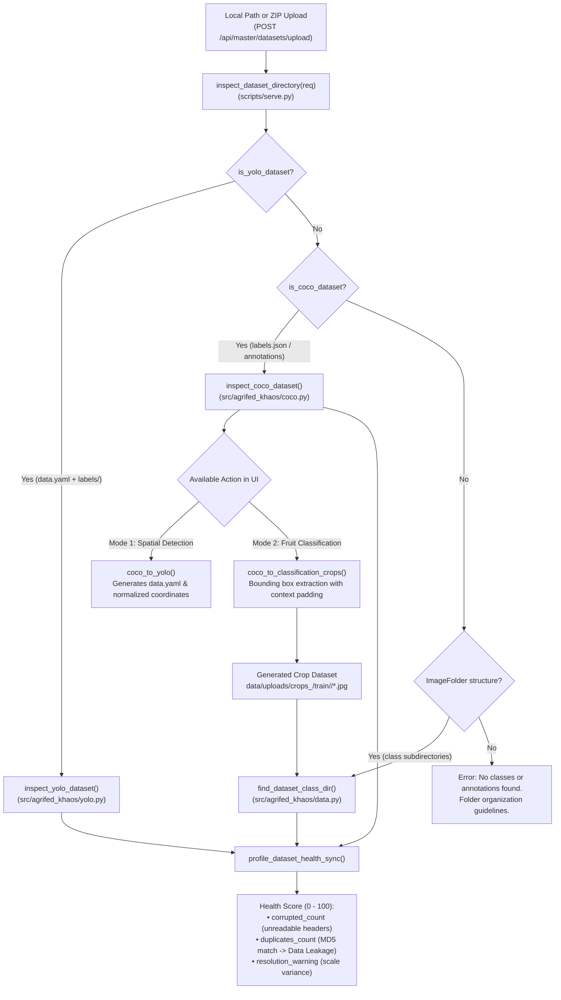
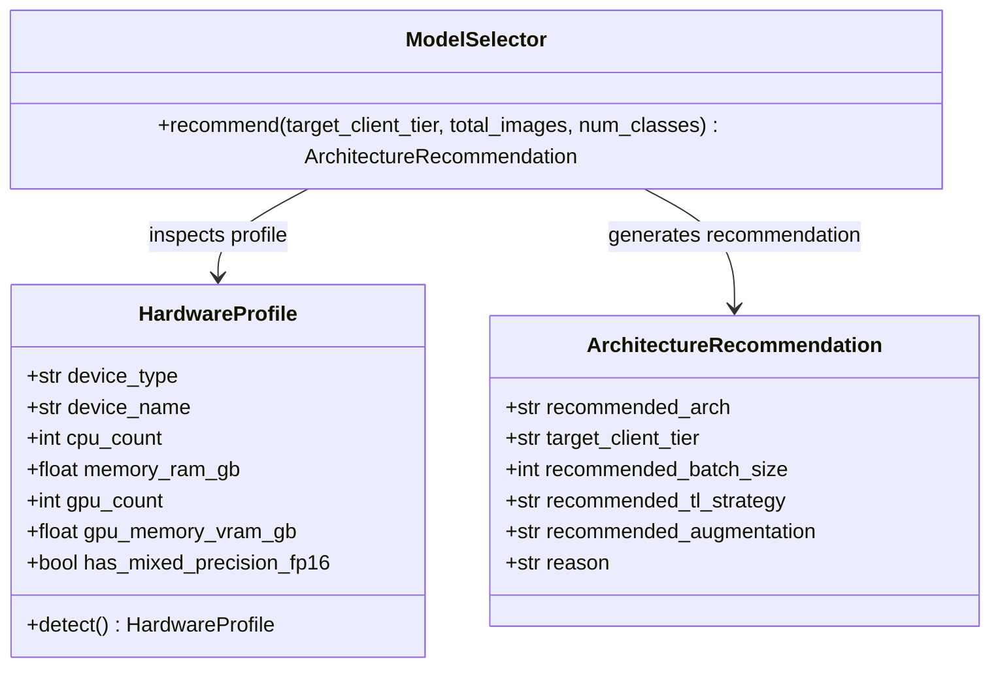
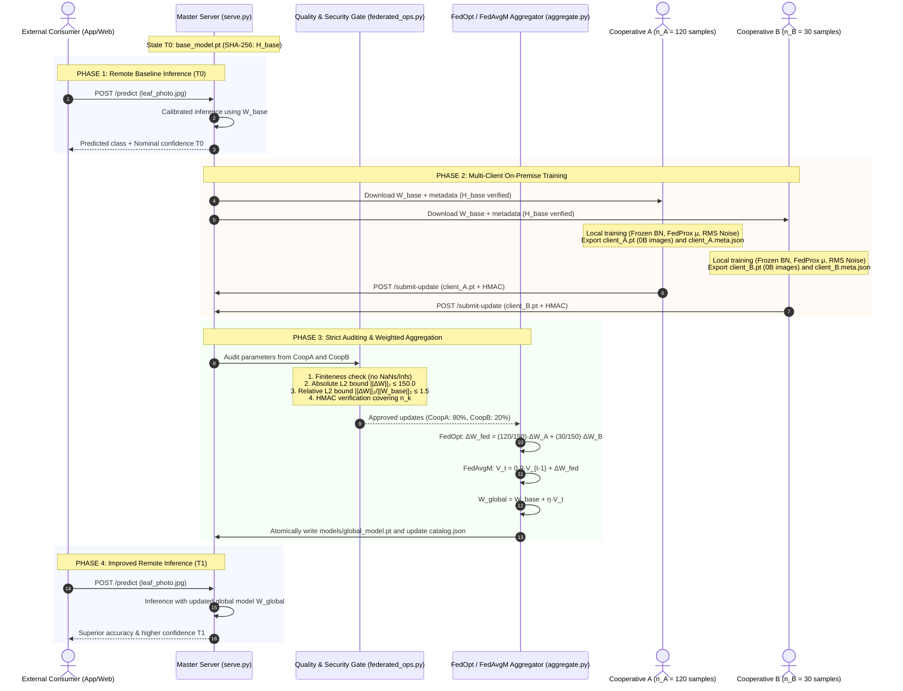
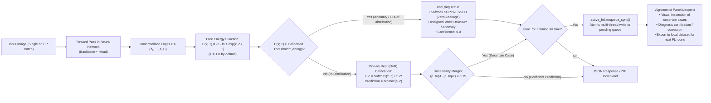

# System Architecture: AgriFed-KHAOS

> English documentation. Versión en español disponible en [docs/architecture.md](architecture.md).

Technical specification, topology, and architectural design document for **AgriFed-KHAOS**, a modular framework for Federated Learning (FL), Computer Vision, and edge MLOps in agriculture and industrial visual quality assurance.

---

## 1. Design Principles & Engineering Standards

The framework is architected according to modern software engineering, SOLID principles, and MLOps design patterns:

1. **Domain-Agnostic Core:**  
   The core algorithmic engine does not hardcode or assume any specific crop or visual pathology. It operates over arbitrary vision tensors regardless of whether the task is leaf pathology, fruit grading, or industrial defect detection.
2. **Zero-Config Universal Ingestion:**  
   The user simply provides a dataset (local directory or compressed `.ZIP` file). The ingestion subsystem automatically detects the format (`ImageFolder`, `COCO JSON`, `Ultralytics YOLO`), profiles dataset health, and recommends the optimal architecture.
3. **Adapter Pattern & Decoupling (OCP & DIP):**  
   The [`BaseFLWrapper`](../src/agrifed_khaos/wrappers.py) abstraction decouples federated communication runtimes (Flower / NumPy arrays) from underlying deep learning backbones (PyTorch, Timm, Ultralytics YOLO).
4. **Zero Data Leakage Contract:**  
   Raw physical images and local annotations strictly never leave the perimeter infrastructure of edge client nodes. The network solely transports audited, cryptographically signed model parameters ($\Delta W$).
5. **Strict Auditing & Byzantine Resilience:**  
   No client update is merged into the global model without passing deterministic verification gates: closed schema matching, numeric finitude, L2 divergence bounds, and HMAC authentication.
6. **Active Expert Validation Loop (Human-In-The-Loop / HITL):**  
   High-uncertainty samples or anomalous inputs (detected via the Free Energy Out-of-Distribution guardrail) are captured in real time for expert certification and subsequent federated retraining rounds.

---

## 2. End-to-End Master Pipeline Diagram

The following diagram presents the comprehensive, holistic view of AgriFed-KHAOS from data ingestion to federated deployment and active field evaluation:

```mermaid
flowchart TD
    subgraph S1 ["1. UNIVERSAL INGESTION & PROFILING (Zero-Config)"]
        RawData["Input Dataset (Directory or .ZIP archive)"] --> Inspector["Universal Dataset Inspector\n(scripts/serve.py + src/agrifed_khaos/coco.py)"]
        Inspector --> Discrim{"Heuristic Format Discriminator"}
        Discrim -- "labels.json / instances_*.json" --> COCO_Mod["COCO Parser Engine\n(src/agrifed_khaos/coco.py)"]
        Discrim -- "data.yaml + images/ + labels/" --> YOLO_Mod["YOLO Parser Engine\n(src/agrifed_khaos/yolo.py)"]
        Discrim -- "Class Subdirectories" --> Class_Mod["ImageFolder Classifier Engine\n(src/agrifed_khaos/data.py)"]
        
        COCO_Mod --> HealthCheck["Health & Integrity Profiler\n• Corrupted files check\n• Exact MD5 duplicates\n• Scale resolution variance"]
        YOLO_Mod --> HealthCheck
        Class_Mod --> HealthCheck
    end

    subgraph S2 ["2. STRATEGIC DISPATCH & AUTO-FL"]
        HealthCheck --> Strategy{"Selected Strategy"}
        Strategy -- "Direct Spatial Detection" --> Prep_Det["YOLO / Bounding Box Preparation"]
        Strategy -- "Auto-Crop for Classification" --> AutoCrop["Auto-Crop Engine\n(Patch extraction with context padding)"]
        Strategy -- "Direct Image Classification" --> Prep_Class["Canonical ImageFolder Structure"]

        AutoCrop --> Prep_Class

        Prep_Det --> SelectorDet["ModelSelector (Detection)\n• Edge CPU: SSDLite MobileNetV3 / YOLOv11n\n• Server GPU: Faster R-CNN"]
        Prep_Class --> SelectorClass["ModelSelector (Classification)\n• cpu-low: MobileNetV3 / ResNet-18\n• cpu-high: EfficientNet-B0\n• gpu: EfficientNet-V2-S / ConvNeXt"]
    end

    subgraph S3 ["3. TRAINING & FEDERATED ORCHESTRATION"]
        SelectorClass --> BaseTrain["Base Model Trainer (scripts/train_base.py)\n• Frozen BN Statistics\n• Balanced Cross-Entropy / Focal Loss\n• Self-Contained Checkpoint Bundle (.pt)"]
        SelectorDet --> BaseTrainDet["Detection Trainer (scripts/train_detection.py)\n• CIoU / GIoU Box Loss\n• mAP@50 / mAP@50:95 Evaluation"]

        BaseTrain --> MasterOrch["Master Host Orchestrator\nmodels/catalog.json + models/metadata.json"]
        BaseTrainDet --> MasterOrch

        MasterOrch -->|"Distribute W_base (SHA-256)"| Clients["Perimeter Edge Nodes (K Cooperatives)\nscripts/client_trainer.py\n• FedProx Proximal Loss (μ)\n• Adaptive RMS Noise Perturbation\n• Parameter Export ΔW (0B Images)"]

        Clients -->|"Parameter Updates ΔW + HMAC"| SecGate["Quality & Security Gate\n• Finiteness (No NaNs/Infs)\n• Absolute L2 Bound ||ΔW||₂ ≤ τ\n• Relative L2 Bound ||ΔW||₂/||W_base||₂ ≤ τ_rel\n• HMAC-SHA256 authenticating num_samples"]

        SecGate --> Aggregator["Sample-Weighted FedOpt + FedAvgM Aggregator\nΔW_fed = Σ (n_k / N) · ΔW_k\nV_t = β · V_{t-1} + ΔW_fed\nW_global = W_base + η · V_t"]
        Aggregator --> GlobalModel["Updated Global Model\nmodels/global_model.pt"]
    end

    subgraph S4 ["4. SERVING, INFERENCE & EXPERT ACTIVE LEARNING (HITL)"]
        GlobalModel --> Serving["REST Inference Engine (scripts/serve.py)\n• GET /health\n• POST /predict (Single image)\n• POST /api/predict/batch (ZIP batches)"]

        Serving --> Guardrail{"Zero-Leakage OoD Guardrail\n(Free Energy E(x; T))"}
        Guardrail -- "In-Distribution (Energy ≤ τ)" --> OutputPred["Calibrated OvR Inference\n• Rescaled probabilities\n• Bounding box overlay canvas\n• Grad-CAM heatmaps"]
        Guardrail -- "Out-of-Distribution / Anomaly" --> OoDAlert["OoD Anomaly Flag\nSoftmax SUPPRESSED for reliability"]

        OutputPred --> HITLQueue["HITL Active Learning Queue (src/agrifed_khaos/hitl.py)\n• Thread-safe atomic persistence (enqueue_sync)\n• Uncertainty sampling (Margin Sampling)"]
        OoDAlert --> HITLQueue

        HITLQueue --> ExpertUI["Expert Agronomist Panel (/expert)\n• Pathology certification\n• Ground-truth label correction for next FL round"]
    end
```

---

## 3. Subsystem Architectural Breakdown

---

### Subsystem 1: Universal Data Ingestion, Format Detection & Health Profiling

The ingestion layer enables users to upload heterogeneous vision datasets while the system automatically discovers the structure and proposes the best processing path.

#### Technical Capabilities:
1. **Automated COCO Discovery (`src/agrifed_khaos/coco.py`):**
   * Recursively scans directories up to depth 3 for JSON descriptors (`labels.json`, `instances_*.json`, `annotations.json`).
   * Validates schema signatures (`categories`, `images`, `annotations`).
   * Automatically resolves sibling image folders (`images/`, split directories, or adjacent images).
2. **Auto-Crop Engine (`coco_to_classification_crops`):**
   * Extracts individual object instances with configurable visual context padding ($\text{padding} = 5\%$).
   * Filters noise boxes below minimum resolution thresholds ($\text{min\_box\_size} \ge 24\text{ px}$).
   * Organizes generated crops into canonical `ImageFolder` hierarchies ready for any classifier backbone.
3. **Anti-Data-Leakage Protection:**
   * Streams 64KB chunked MD5 binary hashes to prevent identical image leakage between train and test partitions.

---

### Subsystem 2: Autonomous Architecture Selection (Auto-FL Aware)

In federated settings, master server capabilities do not dictate model complexity; the bottleneck is edge client compute. [`ModelSelector`](../src/agrifed_khaos/hardware.py) jointly optimizes architecture based on client tier and dataset characteristics:

#### Architecture Recommendation Matrix:

| Client Tier (`target_client_tier`) | Task | Sample Volume ($N$) | Recommended Architecture | Transfer Learning Strategy | Augmentation Strategy |
|---|---|---|---|---|---|
| **`cpu-low`** | Classification | $N < 1,000$ | `resnet18` (~11.7M) | Linear Probing (`head_only`) | Basic (Flips + Crops) |
| **`cpu-low`** | Classification | $1,000 \le N \le 5,000$ | `mobilenet_v3_large` (~5.4M) | Partial Fine-Tuning (`partial`) | Basic |
| **`cpu-low`** | Detection | Any $N$ | `ssdlite320_mobilenet_v3_large` | Frozen backbone | Multi-Scale Rescale |
| **`cpu-high`** | Classification | $1,000 \le N \le 5,000$ | `efficientnet_b0` (~5.3M) | Partial Fine-Tuning (`partial`) | Basic |
| **`cpu-high`** | Detection | Any $N$ | `yolo11n` (~2.6M) | Head Fine-Tuning | Mosaic + HSV Augment |
| **`gpu`** | Classification | $N > 5,000$ | `efficientnet_v2_s` (~21.5M) | Partial Fine-Tuning (`partial`) | Heavy `RandAugment` |
| **`gpu`** | Detection | $N > 5,000$ | `fasterrcnn_resnet50_fpn_v2` | FPN + RoI Heads | Multi-Scale Heavy |

---

### Subsystem 3: Federated Lifecycle, Security Gates & Sample-Weighted Aggregation

The federated learning lifecycle ensures strict data containment and Byzantine fault tolerance across four phases:

#### Mathematical Formulations:

1. **Local Proximal Regularization (FedProx):**
   $$
   \mathcal{L}_{\text{prox}}(W; W_{\text{base}}) = \mathcal{L}_{\text{CE}}(W; X, Y) + \frac{\mu}{2} \sum_{l=1}^{L} \| W_l - W_{l,\text{base}} \|_2^2
   $$
2. **Relative L2 Divergence Gate:**
   $$
   \delta_{\text{rel}} = \frac{\|\Delta W\|_2}{\max(\|W_{\text{base}}\|_2, 10^{-8})} \le \tau_{\text{rel}} \quad (\text{default } \tau_{\text{rel}} = 1.5)
   $$
3. **Multi-Client Aggregation with Server Momentum (FedAvgM):**
   $$
   \Delta W_{\text{fed}} = \sum_{k=1}^{K} \frac{n_k}{N} (W_k - W_{\text{base}})
   $$
   $$
   V_t = \beta V_{t-1} + \Delta W_{\text{fed}}, \quad W_{\text{global}} = W_{\text{base}} + \eta V_t
   $$

---

### Subsystem 4: Inference Serving, OoD Guardrail & Human-In-The-Loop (HITL)

To safeguard model trustworthiness against unrepresented visual domains, inference decouples confidence estimation using a **Free Energy Guardrail**:

---

## 4. Threat Model & Security Boundaries

To maintain rigorous transparency, formal security guarantees and out-of-scope boundaries are explicitly specified:

### A. Covered In-Scope Guarantees
* **Zero Raw Media Leakage:** Training images and labels never leave client infrastructure (`0 bytes` of media transferred).
* **Minimal Attack Surface (Head-Only):** In classifier fine-tuning (`--head-only`), 100% of the convolutional extractor remains untouched; only the linear classification matrix is exported ($\approx 18\text{ KB}$), preventing activation inversion attacks.
* **Local Heuristic Perturbation:** L2 clipping ($C_{\text{clip}}$) and adaptive RMS noise ($\sigma \cdot \text{RMS}$) distort exported gradients before leaving client nodes.
* **Deterministic Cryptographic Integrity:** In-memory SHA-256 digests and HMAC-SHA256 signatures certify parameters were not altered in transit.

### B. Out-of-Scope Known Boundaries
1. **Absence of Secure Multi-Party Computation (SecAgg):**  
   The master server receives parameter updates $\Delta W_k$ individually before aggregation. The server is assumed **authorized and trusted**. Distributed homomorphic aggregation without prior decryption is not implemented.
2. **No Formal $(\epsilon, \delta)$ Differential Privacy Guarantee:**  
   Gaussian noise perturbation provides heuristic defense against gradient inversion; it does not compute a formal Rényi DP privacy budget.
3. **Transport Layer Security (TLS/HTTPS Required in Production):**  
   Outside isolated local testbeds, production deployments must run HTTPS via FastAPI native TLS certificates or through a reverse proxy (Nginx, Caddy, or Traefik).
