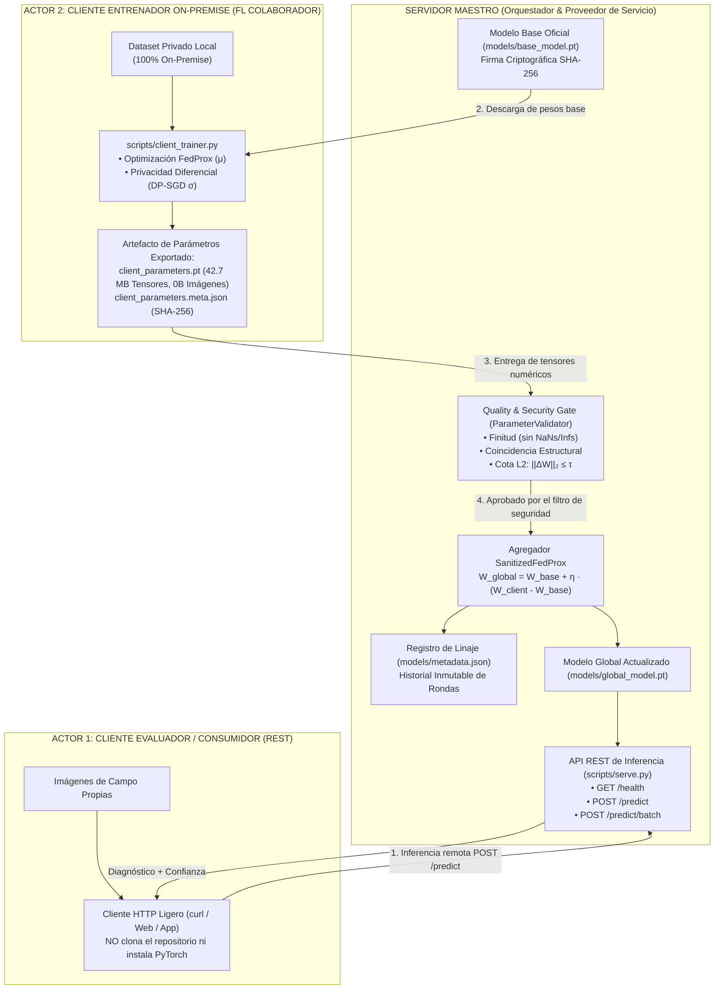
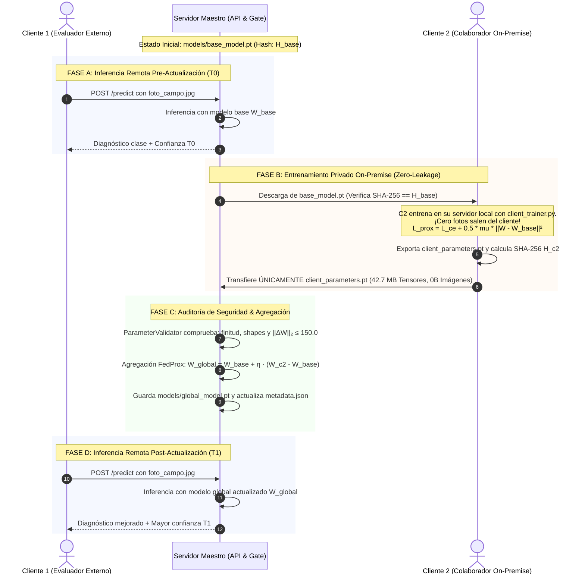

# Arquitectura del Sistema: AgriFed-KHAOS

Documento de especificación técnica y decisiones arquitectónicas de **AgriFed-KHAOS**, framework modular de Aprendizaje Federado (*Federated Learning*, FL) orientado a Visión Artificial.

---

## 1. Principios de Diseño y Estándares SOLID

El framework está concebido bajo estándares de ingeniería de software y MLOps modernos:

1. **Agnosticismo de Dominio (Domain-Agnostic Core):** El núcleo del framework no conoce ni depende de ningún cultivo, planta o patología específica. Opera sobre tensores arbitrarios de imágenes agrupadas en estructuras de clases estándar (`ImageFolder`) o manifiestos anotados.
2. **Desacoplamiento Data-Centric (Principio de Inversión de Dependencias - DIP):** La curación, filtrado de calidad y normalización de datos corresponden exclusivamente al repositorio hermano [`agrivision-khaos`](../../agrivision-khaos). `AgriFed-KHAOS` asume que los datos locales del cliente son un estándar de oro y se concentra únicamente en la optimización distribuida y la agregación de pesos.
3. **Patrón Adaptador (Adapter Pattern - Principio Abierto/Cerrado - OCP):** La abstracción [`BaseFLWrapper`](../src/agrifed_khaos/wrappers.py#L119) desacopla por completo el runtime de comunicación federada (Flower / tensores NumPy) de los frameworks subyacentes de deep learning (PyTorch, Timm, Ultralytics YOLO).
4. **Cero Fuga de Datos (Zero Data Leakage Contract):** Los datos físicos en bruto (imágenes RGB y etiquetas locales) jamás abandonan el host perimetral del cliente. La red solo transporta parámetros matemáticos y firmas criptográficas.

---

## 2. Topología del Sistema y Modelo de Tres Actores

---

## 3. Componentes Arquitectónicos Clave

### A. Patrón Adaptador de Modelos (`BaseFLWrapper`)

Flower y los orquestadores distribuidos requieren listas planas de matrices NumPy (`list[np.ndarray]`). Los modelos de visión artificial gestionan parámetros de capas y buffers de estado (`torch.nn.Parameter`, `state_dict`).

* [`BaseFLWrapper`](../src/agrifed_khaos/wrappers.py#L119): Interfaz abstracta que exige:
  - `get_parameters() -> list[np.ndarray]`
  - `set_parameters(parameters: Sequence[np.ndarray]) -> None`
  - `train_local_epoch(train_data, epochs, prox_mu, reference_parameters) -> TrainingStats`
  - `evaluate(eval_data) -> EvaluationStats`
* [`TorchModuleWrapper`](../src/agrifed_khaos/wrappers.py#L167): Implementación genérica para arquitecturas PyTorch. **Aísla exclusivamente los parámetros con `requires_grad=True`**, omitiendo buffers volátiles de normalización (como `running_mean` o `num_batches_tracked` de BatchNorm) que causan inconsistencias dimensionales en la optimización proximal.
* [`TimmClassificationWrapper`](../src/agrifed_khaos/wrappers.py#L305): Factoría para inicializar cualquier backbone moderno de Vision Transformer (ViT) o CNN mediante `timm`.
* [`YOLOv8Wrapper`](../src/agrifed_khaos/wrappers.py#L338): Adaptador para redes de detección y segmentación de Ultralytics.

---

### B. Regularización FedProx y Función de Pérdida Proximal

En escenarios federados agrícolas o industriales, las distribuciones locales son altamente **No-IID** (desbalance de clases por clima, cámara, variedad). Para prevenir la divergencia del cliente (*client drift*), el entrenamiento local aplica la función de pérdida proximal de **FedProx**:

$$\mathcal{L}_{\text{prox}}(W; W_{\text{ref}}) = \mathcal{L}_{\text{CE}}(W; X, Y) + \frac{\mu}{2} \sum_{l=1}^{L} \| W_l - W_{l,\text{ref}} \|_2^2$$

Donde:
* $\mathcal{L}_{\text{CE}}$ es la entropía cruzada del lote local.
* $\mu \ge 0$ es el hiperparámetro proximal (por defecto $0.01$).
* $W_{\text{ref}}$ son los pesos del modelo global ancla transmitidos por el servidor al inicio de la ronda.

---

### C. Puerta de Calidad y Seguridad (`ParameterValidator`)

Todo vector de parámetros recibido por el servidor central es auditado de forma determinista antes de su incorporación:

1. **Integridad Estructural:** Coincidencia estricta en el número de tensores, formas dimensionales (`shape`) y tipo de dato (`dtype`).
2. **Finitud Numérica:** Verificación estricta de ausencia total de valores no finitos (`NaN` o `Inf`).
3. **Cota de Divergencia Euclidiana ($L_2$ Gate):**
   $$\|\Delta W\|_2 = \sqrt{\sum_{i=1}^N \sum_{j} (W_{i,j}^{\text{cliente}} - W_{i,j}^{\text{base}})^2} \le \tau$$
   Si $\|\Delta W\|_2 > \tau$ (por defecto $\tau = 150.0$), la actualización es rechazada automáticamente, mitigando ataques de envenenamiento de modelo (*Sybil attacks* / *Model Replacement*).

---

### D. Privacidad Diferencial (DP-SGD) en el Cliente

Para evitar que un servidor central no confiable reconstruya imágenes mediante ataques de inversión de gradiente (*Deep Leakage from Gradients*, DLG), el cliente puede activar ruido de privacidad diferencial antes de exportar sus pesos:

$$W_{\text{export}} = W_{\text{local}} + \mathcal{N}(0, \sigma^2 \mathbf{I})$$

Donde $\sigma$ es la desviación estándar del ruido gaussiano calibrado.

---

### E. Gobernanza de Modelos y Linaje Criptográfico (SHA-256)

Cada checkpoint generado incorpora una huella digital inmutable:
* **Modelo Base:** Se almacena con su digest SHA-256, hiperparámetros de entrenamiento y lista de clases en [`models/metadata.json`](../models/metadata.json).
* **Actualización del Cliente:** Genera un manifiesto [`client_parameters.meta.json`](../models/client_parameters.meta.json) vinculando el SHA-256 de los pesos locales y el SHA-256 del modelo base del cual desciende.
* **Agregación Global:** [`scripts/aggregate.py`](../scripts/aggregate.py) registra un historial inmutable de rondas (`aggregation_history`) conteniendo los hashes de entrada, la norma $\|\Delta W\|_2$ verificada y el hash del nuevo checkpoint.

---

## 4. Diagrama de Secuencia: Ciclo de Vida Federado Completo

