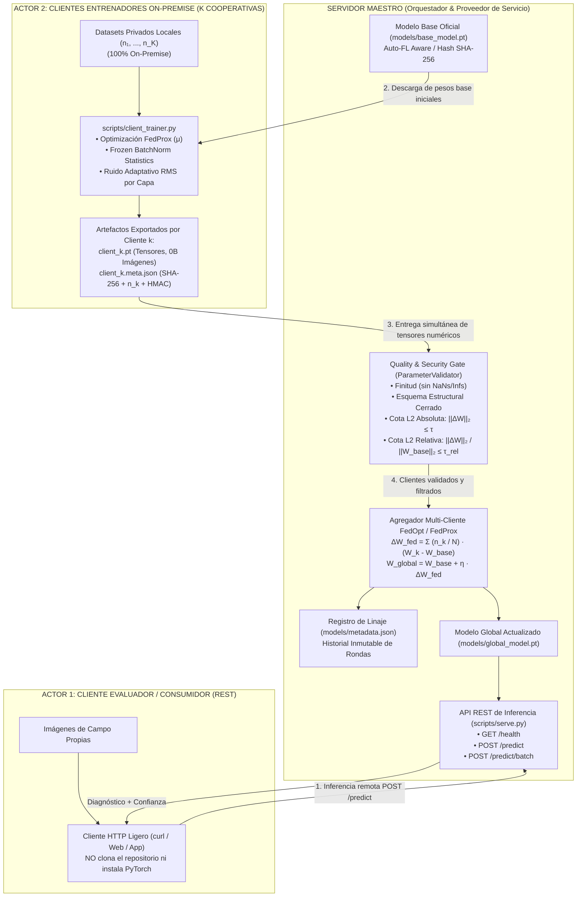
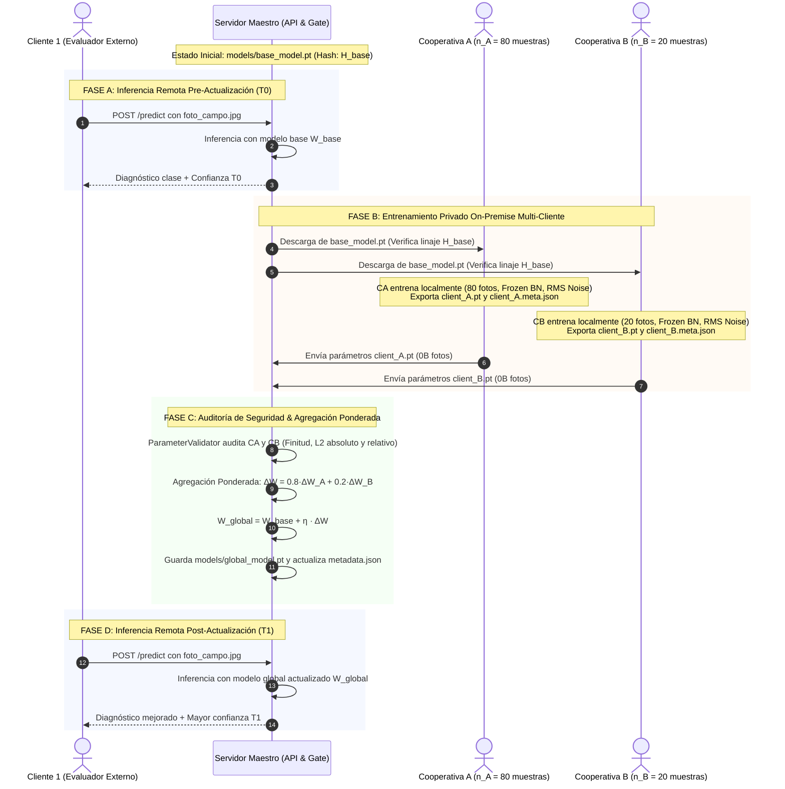

# Arquitectura del Sistema: AgriFed-KHAOS

> Versión en español. English version available in [docs/architecture.en.md](architecture.en.md).

Documento de especificación técnica y decisiones arquitectónicas de **AgriFed-KHAOS**, framework modular de Aprendizaje Federado (*Federated Learning*, FL) orientado a Visión Artificial.

---

## 1. Principios de Diseño y Estándares SOLID

El framework está concebido bajo estándares de ingeniería de software y MLOps modernos:

1. **Agnosticismo de Dominio (Domain-Agnostic Core):** El núcleo del framework no conoce ni depende de ningún cultivo, planta o patología específica. Opera sobre tensores arbitrarios de imágenes agrupadas en estructuras de clases estándar (`ImageFolder`) o manifiestos anotados.
2. **Desacoplamiento Data-Centric (Principio de Inversión de Dependencias - DIP):** La curación, filtrado de calidad y normalización de datos corresponden exclusivamente al repositorio hermano [`agrivision-khaos`](https://github.com/Diegodepab/agrivision-khaos). `AgriFed-KHAOS` asume que los datos locales del cliente son un estándar de oro y se concentra únicamente en la optimización distribuida y la agregación de pesos.
3. **Patrón Adaptador (Adapter Pattern - Principio Abierto/Cerrado - OCP):** La abstracción [`BaseFLWrapper`](../src/agrifed_khaos/wrappers.py) desacopla por completo el runtime de comunicación federada (Flower / tensores NumPy) de los frameworks subyacentes de deep learning (PyTorch, Timm, Ultralytics YOLO).
4. **Cero Fuga de Datos (Zero Data Leakage Contract):** Los datos físicos en bruto (imágenes RGB y etiquetas locales) jamás abandonan el host perimetral del cliente. La red solo transporta parámetros matemáticos y firmas criptográficas.

---

## 2. Topología del Sistema y Modelo Multi-Cliente



---

## 3. Componentes Arquitectónicos Clave

### A. Selección Autónoma de Arquitectura (Auto-FL Aware)

En Aprendizaje Federado, el hardware del servidor maestro (que puede contar con potentes GPUs) no debe condicionar la arquitectura del modelo. El cuello de botella reside en los clientes perimetrales (cooperativas en CPUs modestas). 

[`ModelSelector`](../src/agrifed_khaos/hardware.py) analiza:
1. **Perfil de Cliente Objetivo (`target_client_tier`):**
   - `cpu-low`: Dispositivos perimetrales básicos $\rightarrow$ Prioriza `mobilenetv4_conv_small` (~3.8M params, score 98).
   - `cpu-high`: Servidores locales en cooperativas $\rightarrow$ Prioriza `resnet18` (~11.7M params, score 95).
   - `gpu`: Estaciones de trabajo dedicadas $\rightarrow$ Evalúa `convnext_tiny` (~28.6M params).
2. **Características del Dataset de Entrada:**
   - Detecta si el dataset tiene pocas muestras ($N < 1.000$) y penaliza severamente los Vision Transformers (ViT), evitando sobreajuste prematuro en datos escasos.

---

### B. Estrategia Unificada *Frozen BatchNorm Statistics* (`freeze_bn_stats`)

En entrenamientos federados No-IID, permitir que las capas `BatchNorm` actualicen sus buffers (`running_mean` y `running_var`) con los lotes locales desestabiliza la distribución global y contradice la convergencia.

* **Congelación Activa (`freeze_bn_stats`):** En [`wrappers.py`](../src/agrifed_khaos/wrappers.py) y [`client_trainer.py`](../scripts/client_trainer.py), todas las capas `_BatchNorm` se fuerzan a modo `eval()`, bloqueando la acumulación de estadísticas locales.
* **Preservación de Pesos Afines:** Los parámetros afines entrenables (`bn.weight`, `bn.bias` con `requires_grad=True`) se adaptan normalmente durante la optimización.
* **Invarianza en el Servidor:** La compuerta de agregación [`scripts/aggregate.py`](../scripts/aggregate.py) preserva bit a bit los buffers de normalización del modelo base en `models/global_model.pt`.

---

### C. Regularización FedProx y Función de Pérdida Proximal

Para mitigar el desvío del cliente (*client drift*) inducido por distribuciones No-IID locales, el entrenamiento aplica la regularización proximal de **FedProx**:

$$
\mathcal{L}_{\text{prox}}(W; W_{\text{ref}}) = \mathcal{L}_{\text{CE}}(W; X, Y) + \frac{\mu}{2} \sum_{l=1}^{L} \| W_l - W_{l,\text{ref}} \|_2^2
$$

Donde $\mu \ge 0$ es el hiperparámetro proximal (por defecto $0.01$) y $W_{\text{ref}}$ es el ancla base global.

---

### D. Puerta de Seguridad y Métricas de Divergencia (`ParameterValidator`)

Todo vector de parámetros recibido es auditado de forma determinista mediante tres compuertas:

1. **Integridad Estructural Cerrada:** Coincidencia exacta del esquema:
   - Esquema Head-Only: sólo los tensores clasificadores (`fc.*`, `classifier.*`).
   - Esquema Full-Model: todos los tensores del modelo base sin claves extras ni faltantes.
2. **Finitud Numérica:** Ausencia total de valores no finitos (`NaN` o `Inf`).
3. **Cota de Divergencia Absoluta (L2 Gate):**

   $$
   \|\Delta W\|_2 = \sqrt{\sum (W^{\text{cliente}} - W^{\text{base}})^2} \le \tau \quad (\text{defecto } \tau = 150.0)
   $$

4. **Cota de Divergencia Relativa (`max_relative_norm`):**

   $$
   \delta_{\text{rel}} = \frac{\|\Delta W\|_2}{\max(\|W_{\text{base}}\|_2, 10^{-8})} \le \tau_{\text{rel}}
   $$

   Permite blindar modelos `--head-only` contra rotaciones desproporcionadas en subconjuntos reducidos de parámetros (~4.600 pesos), donde una cota absoluta de 150.0 resultaría ineficaz.

---

### E. Perturbación Adaptativa RMS por Capa (`apply_adaptive_rms_noise`)

Para mitigar riesgos de reconstrucción o ataques de inversión de pesos (*Deep Leakage from Gradients*), el cliente puede inyectar ruido gaussiano escalado por la raíz de la media cuadrática (RMS) de cada capa:

$$
\text{rms}(p) = \max\left(\frac{\|p\|_2}{\sqrt{p.\text{numel}()}}, 10^{-4}\right)
$$

$$
W_{\text{export}} = W_{\text{local}} + \mathcal{N}(0, \mathbf{I}) \cdot \sigma \cdot \text{rms}(p)
$$

Donde $\sigma$ es el parámetro `--noise-std`. Esto garantiza una relación señal-ruido uniforme por capa, protegiendo tensores de baja magnitud (como `bias`) de ser destruidos.

---

### F. Agregación Multi-Cliente Ponderada por Muestras (`FedOpt`)

[`scripts/aggregate.py`](../scripts/aggregate.py) admite múltiples clientes simultáneos (`--client-weights c1.pt c2.pt ...`):

1. **Ponderación por Muestras Locales:**
   Dados $K$ clientes aprobados con muestras $n_1, \dots, n_K$ y masa muestral agregada $N = \sum_{k=1}^K n_k$:

   $$
   \Delta W_{\text{fed}} = \sum_{k=1}^{K} \frac{n_k}{N} (W_k - W_{\text{base}})
   $$

   $$
   W_{\text{global}} = W_{\text{base}} + \eta \cdot \Delta W_{\text{fed}}
   $$

2. **Blindaje Criptográfico HMAC de `num_samples`:**
   El número de muestras $n_k$ se autentica dentro del HMAC-SHA256 del manifiesto mediante una cadena canónica delimitada:

   ```text
   HMAC-SHA256(key, "sha256=" + H_c + "|base_sha256=" + H_b + "|scope=" + S + "|client_id=" + ID + "|num_samples=" + n_k)
   ```

   Esto impide que un nodo malicioso infle artificialmente su peso $n_k$ en la agregación global.
3. **Resiliencia ante Fallos (`--skip-invalid-clients`):**
   Si uno de los clientes enviados no supera alguna compuerta de seguridad, el servidor puede descartarlo con una advertencia y continuar la ronda con los clientes válidos.

---

## 4. Diagrama de Secuencia: Ciclo de Vida Federado Completo



---

## 5. Especificación Técnica de Capacidades v1.0

### A. Checkpoints Autocontenidos (`save_checkpoint_bundle` / `load_checkpoint_bundle`)
Para desacoplar el ciclo de inferencia y entrenamiento de dependencias de rutas externas, los checkpoints `.pt` se empaquetan como diccionarios estructurados:
```python
{
    "state_dict": OrderedDict[str, torch.Tensor],
    "metadata": {
        "architecture": "resnet18",
        "num_classes": C,
        "classes": ["clase_0", ..., "clase_{C-1}"],
        "img_size": 224,
        "calibrated_thresholds": {"clase_0": 0.45, ...}  # opcional
    }
}
```
Las funciones [`load_checkpoint_bundle`](../src/agrifed_khaos/models.py) y [`save_checkpoint_bundle`](../src/agrifed_khaos/models.py) mantienen retrocompatibilidad transparente con tensores crudos (`state_dict` puro) aplicando deserialización segura estricta (`weights_only=True` por defecto), neutralizando vectores de inyección de código arbitrario (CWE-502) en checkpoints federados.

### B. Remapeo Canónico y Protección de Clases Ausentes
1. **Remapeo Canónico:** `torchvision.datasets.ImageFolder` asigna índices `0..K-1` alfabéticamente a las carpetas locales. Si el cliente solo posee un subconjunto de clases, estos índices no coincidirían con el modelo base. [`client_trainer.py`](../scripts/client_trainer.py) reasigna explícitamente `dataset.targets` contra la lista nominal canónica `base_meta["classes"]`.
2. **Hard Projection Post-Step:** Para clases ausentes en el lote local, el gradiente cero no es suficiente frente a términos de momento y regularización FedProx. Tras cada `optimizer.step()`, se proyectan duramente los parámetros:

   $$
   W_{\text{head}}[\text{missing}, :] \leftarrow W_{\text{base}}[\text{missing}, :]
   $$

   $$
   b_{\text{head}}[\text{missing}] \leftarrow b_{\text{base}}[\text{missing}]
   $$

   Garantizando una invariancia numérica exacta ($\Delta W = 0$) en las neuronas no entrenadas.

### C. Expansión Dinámica de Clases (`--allow-new-classes`)
Cuando un cliente perimetral descubre patologías no vistas en el modelo base:
1. **Inicialización Determinista CRC32:** En lugar de depender de semillas globales del RNG que desincronizan cliente y servidor, cada fila de la matriz para la clase emergente $c$ se inicializa usando:

   $$
   \text{seed} = \text{CRC32}(c.\text{encode}()) \pmod{2^{31}-1}
   $$

   Tanto [`expand_model_classifier`](../src/agrifed_khaos/models.py) (cliente) como [`expand_state_dict_classifier`](../src/agrifed_khaos/models.py) (servidor) generan idénticos pesos de partida Kaiming Uniform, permitiendo que la compuerta de seguridad evalúe únicamente el gradiente genuino del cliente.
2. **Alineación Nominal:** En [`aggregate.py`](../scripts/aggregate.py), la función `align_client_head` alinea las filas del clasificador por coincidencia nominal de clase (`target_idx = union_classes.index(cls)`), admitiendo expansiones disjuntas concurrentes.

### D. Perturbación de Parámetros (Mecanismo Gaussiano sobre ΔW) y FedAvgM
1. **Mecanismo Gaussiano Global (L2):** En [`TorchModuleWrapper`](../src/agrifed_khaos/wrappers.py) y [`client_trainer.py`](../scripts/client_trainer.py), los tensores entrenables concatenados se recortan si la norma excede el umbral de corte $C_{\text{clip}}$:

   $$
   \|\Delta W\|_2 > C_{\text{clip}}
   $$

   Aplicando la transformación de recorte:

   $$
   \Delta W \leftarrow \Delta W \cdot \min\left(1, \frac{C_{\text{clip}}}{\|\Delta W\|_2}\right)
   $$

   Y añadiendo ruido gaussiano calibrado:

   $$
   \mathcal{N}\left(0, \sigma^2 C_{\text{clip}}^2 \mathbf{I}\right)
   $$

   Con exención explícita de los buffers de normalización (evitando distorsionar medias y varianzas de BatchNorm).
   *(Nota metodológica: Este mecanismo perturba heurísticamente los parámetros compartidos frente a reconstrucción directa; no evalúa una cota analítica formal $(\epsilon, \delta)$ mediante contabilidad Rényi/Moments).*

2. **FedAvgM (Server Momentum) con Linaje Criptográfico:** [`aggregate.py`](../scripts/aggregate.py) implementa momento del servidor para mitigar el sesgo local (*client drift*) bajo distribuciones no-IID (Hsu et al., 2019):

   $$
   V_t = \beta V_{t-1} + \Delta W_{\text{fed}}, \quad W_{\text{global}} = W_{\text{base}} + \eta V_t
   $$

   * **Configuración y Calibración:** El factor $\beta = 0.9$ es el valor estándar recomendado en la literatura empírica federada, pero constituye un hiperparámetro sintonizable (`--server-momentum`). En fases piloto, se recomienda validar valores $\beta \in \{0.0, 0.5, 0.9\}$ evaluando la estabilidad en `delta_norm` y el guardarraíl de regresión.
   * **Gobernanza del Buffer de Momento:** El archivo `server_momentum.pt` se guarda como un bundle versionado (`format_version: 2`) que vincula la velocidad a la arquitectura, clases y los hashes criptográficos `parent_base_sha256` y `produced_global_sha256`. Si se ejecuta una agregación sobre un modelo base que no coincide con la cadena histórica, el agregador detecta la divergencia, notifica en logs y reinicia la velocidad a cero para no contaminar el nuevo modelo con inercias de experimentos previos.
   * **Persistencia Segura Post-Commit:** El buffer de momento se escribe atómicamente (vía archivo temporal y `os.replace`) **estrictamente después** de que el checkpoint del modelo global ha sido validado y almacenado en disco.

### E. Calibración Multiclase One-vs-Rest e Inferencia Calibrada
1. **Calibración OvR en `evaluate.py`:** Determina el umbral $\tau_c^*$ que maximiza el F1-Score / Youden para cada una de las $C$ clases independientemente sobre un split de validación (`dataset/val`).
2. **Escalado en `serve.py`:** En `/predict`, las probabilidades se reescalan:

   $$
   s_c = \frac{p_c}{\max(\tau_c^*, 10^{-6})}, \quad \hat{y} = \arg\max_{c} s_c
   $$

   Asegurando detección equitativa en clases minoritarias severamente desbalanceadas.

### F. Ingestión Concurrente Atómica de Actualizaciones
Para garantizar la integridad ante múltiples clientes concurrentes:
1. **Serialización por Cliente:** [`serve.py`](../scripts/serve.py) gestiona un cerrojo asíncrono (`asyncio.Lock`) exclusivo por `client_id`, serializando las peticiones del mismo colaborador y previniendo colisiones de carrera.
2. **Directorio Inmutable Atómico:** Cada actualización se ensambla primero en un directorio temporal `.staging_{stamp}` y se publica atómicamente mediante `os.replace` hacia `models/client_updates/updates/{client_id}/{stamp}/`. Ambos archivos (`parameters.pt` y `parameters.meta.json`) aparecen de forma simultánea e indivisible a nivel de sistema de ficheros POSIX.
3. **Compatibilidad:** El servidor mantiene punteros actualizados atómicamente en `{client_id}_parameters.pt` y archiva copias históricas inmutables en `archive/`.

---

## 5. Modelo de Amenazas y Límites de Privacidad (Threat Model & Boundaries)

Para mantener una transparencia técnica y académica rigurosa, se especifican con precisión las garantías proporcionadas y las limitaciones fuera de alcance del sistema:

### A. Garantías Cubiertas (In-Scope)
* **Cero Fuga de Imágenes en Bruto:** Las imágenes físicas y etiquetas de entrenamiento jamás abandonan la infraestructura perimetral del cliente (`0 bytes` de datos multimedia transferidos).
* **Superficie de Exposición Mínima (Head-Only):** En el ajuste de cabeza (`--head-only`), el 100% del extractor convolucional permanece congelado en el cliente; únicamente se exporta la matriz lineal de clasificación ($\approx 18\text{ KB}$), eliminando vectores de inversión sobre activaciones profundas.
* **Perturbación Heurística Local:** El recorte L2 ($C_{\text{clip}}$) y la inyección gaussiana ($\sigma$) sobre $\Delta W$ distorsionan las actualizaciones locales antes de salir del nodo perimetral.
* **Autenticidad e Integridad Criptográfica:** El cálculo de digests SHA-256 en memoria y la firma HMAC-SHA256 con clave compartida certifican que los parámetros no han sido manipulados en tránsito ni inyectados por actores no autorizados.

### B. Limitaciones Conocidas y Fuera de Alcance (Known Limitations)
1. **Ausencia de Secure Multi-Party Aggregation (SecAgg):**
   El servidor orquestador recibe las actualizaciones de pesos $\Delta W_k$ de cada cliente de forma individual y en claro antes de sumarlas. Por tanto, el orquestador se asume **autorizado y confiable**. Un servidor malicioso o intervenido administrativamente puede inspeccionar los pesos aislados de un cliente. No se implementa un protocolo criptográfico SecAgg (como Bonawitz et al., 2017) basado en secreto compartido u homomórfico.
2. **Sin Garantía Formal $(\epsilon, \delta)$ de Privacidad Diferencial:**
   La adición de ruido gaussiano sobre $\Delta W$ constituye una perturbación de parámetros heurística. El framework no incorpora un contador de privacidad formal (como Rényi DP o Moments Accountant) calibrado con el tamaño del dataset, ratio de muestreo por batch y número total de épocas.
3. **Alcance de la Firma HMAC:**
   La firma HMAC en el manifiesto provee autenticación de origen e integridad de datos; **no proporciona cifrado ni confidencialidad**.
4. **Seguridad en la Capa de Transporte (TLS/HTTPS Obligatorio en Producción):**
   Las cabeceras `Authorization: Bearer <token>` y `X-Client-HMAC` viajan en texto plano a través de la red si se utiliza HTTP estándar. En redes externas o no confiables, el servicio debe desplegarse con TLS nativo (`--ssl-certfile` y `--ssl-keyfile` en [`serve.py`](../scripts/serve.py)) o detrás de un proxy inverso HTTPS (Nginx, Caddy o Traefik).

```nginx
# Ejemplo de configuración recomendada para Nginx Reverse Proxy con TLS
server {
    listen 443 ssl http2;
    server_name agrifed.mi-organizacion.es;

    ssl_certificate /etc/letsencrypt/live/agrifed/fullchain.pem;
    ssl_certificate_key /etc/letsencrypt/live/agrifed/privkey.pem;

    client_max_body_size 60M; # Permite subida de parámetros y manifiestos

    location / {
        proxy_pass http://127.0.0.1:8000;
        proxy_set_header Host $host;
        proxy_set_header X-Real-IP $remote_addr;
        proxy_set_header X-Forwarded-For $proxy_add_x_forwarded_for;
        proxy_set_header X-Forwarded-Proto https;
    }
}
```

