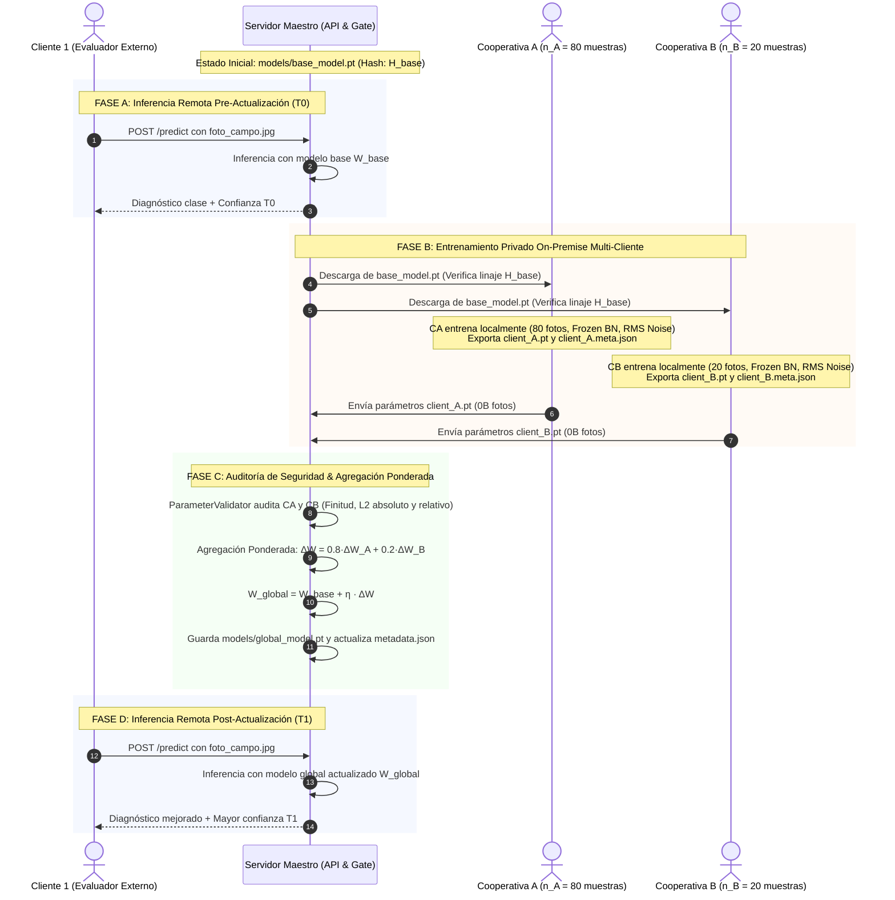

# Arquitectura del Sistema: AgriFed-KHAOS

Documento de especificación técnica y decisiones arquitectónicas de **AgriFed-KHAOS**, framework modular de Aprendizaje Federado (*Federated Learning*, FL) orientado a Visión Artificial.

---

## 1. Principios de Diseño y Estándares SOLID

El framework está concebido bajo estándares de ingeniería de software y MLOps modernos:

1. **Agnosticismo de Dominio (Domain-Agnostic Core):** El núcleo del framework no conoce ni depende de ningún cultivo, planta o patología específica. Opera sobre tensores arbitrarios de imágenes agrupadas en estructuras de clases estándar (`ImageFolder`) o manifiestos anotados.
2. **Desacoplamiento Data-Centric (Principio de Inversión de Dependencias - DIP):** La curación, filtrado de calidad y normalización de datos corresponden exclusivamente al repositorio hermano [`agrivision-khaos`](../../agrivision-khaos). `AgriFed-KHAOS` asume que los datos locales del cliente son un estándar de oro y se concentra únicamente en la optimización distribuida y la agregación de pesos.
3. **Patrón Adaptador (Adapter Pattern - Principio Abierto/Cerrado - OCP):** La abstracción [`BaseFLWrapper`](../src/agrifed_khaos/wrappers.py) desacopla por completo el runtime de comunicación federada (Flower / tensores NumPy) de los frameworks subyacentes de deep learning (PyTorch, Timm, Ultralytics YOLO).
4. **Cero Fuga de Datos (Zero Data Leakage Contract):** Los datos físicos en bruto (imágenes RGB y etiquetas locales) jamás abandonan el host perimetral del cliente. La red solo transporta parámetros matemáticos y firmas criptográficas.

---

## 2. Topología del Sistema y Modelo Multi-Cliente

```mermaid
flowchart TD
    subgraph MasterHost ["SERVIDOR MAESTRO (Orquestador & Proveedor de Servicio)"]
        W_Base["Modelo Base Oficial (models/base_model.pt)<br/>Auto-FL Aware / Hash SHA-256"]
        Metadata["Registro de Linaje (models/metadata.json)<br/>Historial Inmutable de Rondas"]
        Gate["Quality & Security Gate (ParameterValidator)<br/>• Finitud (sin NaNs/Infs)<br/>• Esquema Estructural Cerrado<br/>• Cota L2 Absoluta: ||ΔW||₂ ≤ τ<br/>• Cota L2 Relativa: ||ΔW||₂ / ||W_base||₂ ≤ τ_rel"]
        Aggregator["Agregador Multi-Cliente FedOpt / FedProx<br/>ΔW_fed = Σ (n_k / N) · (W_k - W_base)<br/>W_global = W_base + η · ΔW_fed"]
        W_Global["Modelo Global Actualizado (models/global_model.pt)"]
        REST_API["API REST de Inferencia (scripts/serve.py)<br/>• GET /health<br/>• POST /predict<br/>• POST /predict/batch"]
    end

    subgraph Client1Host ["ACTOR 1: CLIENTE EVALUADOR / CONSUMIDOR (REST)"]
        C1_Data["Imágenes de Campo Propias"]
        C1_Curl["Cliente HTTP Ligero (curl / Web / App)<br/>NO clona el repositorio ni instala PyTorch"]
    end

    subgraph ClientNodes ["ACTOR 2: CLIENTES ENTRENADORES ON-PREMISE (K COOPERATIVAS)"]
        CK_PrivateData["Datasets Privados Locales (n₁, ..., n_K)<br/>(100% On-Premise)"]
        CK_Trainer["scripts/client_trainer.py<br/>• Optimización FedProx (μ)<br/>• Frozen BatchNorm Statistics<br/>• Ruido Adaptativo RMS por Capa"]
        CK_Params["Artefactos Exportados por Cliente k:<br/>client_k.pt (Tensores, 0B Imágenes)<br/>client_k.meta.json (SHA-256 + n_k + HMAC)"]
    end

    C1_Data --> C1_Curl
    C1_Curl -->|1. Inferencia remota POST /predict| REST_API
    REST_API -->|Diagnóstico + Confianza| C1_Curl

    W_Base -->|2. Descarga de pesos base iniciales| CK_Trainer
    CK_PrivateData --> CK_Trainer
    CK_Trainer --> CK_Params
    CK_Params -->|3. Entrega simultánea de tensores numéricos| Gate

    Gate -->|4. Clientes validados (o filtrados con --skip-invalid-clients)| Aggregator
    Aggregator --> W_Global
    Aggregator --> Metadata
    W_Global --> REST_API
```

---

## 3. Componentes Arquitectónicos Clave

### A. Selección Autónoma de Arquitectura (Auto-FL Aware)

En Aprendizaje Federado, el hardware del servidor maestro (que puede contar con potentes GPUs) no debe condicionar la arquitectura del modelo. El cuello de botella reside en los clientes perimetrales (cooperativas en CPUs modestas). 

[`ModelSelector`](../src/agrifed_khaos/hardware.py) analiza:
1. **Perfil de Cliente Objetivo (`target_client_tier`):**
   - `cpu-low`: Dispositivos perimetrales básicos $\rightarrow$ Prioriza `mobilenetv4_conv_small` (~3.8M params, score 98).
   - `cpu-high`: Servidores locales en cooperativas $\rightarrow$ Prioriza `resnet18` (~11.7M params, score 95).
   - `gpu`: Estaciones de trabajo dedicadas $\rightarrow$ Evalúa `convnext_tiny` (~28.6M params).
2. **Características del Dataset de Entrada:**
   - Detecta si el dataset tiene pocas muestras ($N < 1.000$) y penaliza severamente los Vision Transformers (ViT), evitando sobreajuste prematuro en datos escasos.

---

### B. Estrategia Unificada *Frozen BatchNorm Statistics* (`freeze_bn_stats`)

En entrenamientos federados No-IID, permitir que las capas `BatchNorm` actualicen sus buffers (`running_mean` y `running_var`) con los lotes locales desestabiliza la distribución global y contradice la convergencia.

* **Congelación Activa (`freeze_bn_stats`):** En [`wrappers.py`](../src/agrifed_khaos/wrappers.py) y [`client_trainer.py`](../scripts/client_trainer.py), todas las capas `_BatchNorm` se fuerzan a modo `eval()`, bloqueando la acumulación de estadísticas locales.
* **Preservación de Pesos Afines:** Los parámetros afines entrenables (`bn.weight`, `bn.bias` con `requires_grad=True`) se adaptan normalmente durante la optimización.
* **Invarianza en el Servidor:** La compuerta de agregación [`scripts/aggregate.py`](../scripts/aggregate.py) preserva bit a bit los buffers de normalización del modelo base en `models/global_model.pt`.

---

### C. Regularización FedProx y Función de Pérdida Proximal

Para mitigar el desvío del cliente (*client drift*) inducido por distribuciones No-IID locales, el entrenamiento aplica la regularización proximal de **FedProx**:

$$\mathcal{L}_{\text{prox}}(W; W_{\text{ref}}) = \mathcal{L}_{\text{CE}}(W; X, Y) + \frac{\mu}{2} \sum_{l=1}^{L} \| W_l - W_{l,\text{ref}} \|_2^2$$

Donde $\mu \ge 0$ es el hiperparámetro proximal (por defecto $0.01$) y $W_{\text{ref}}$ es el ancla base global.

---

### D. Puerta de Seguridad y Métricas de Divergencia (`ParameterValidator`)

Todo vector de parámetros recibido es auditado de forma determinista mediante tres compuertas:

1. **Integridad Estructural Cerrada:** Coincidencia exacta del esquema:
   - Esquema Head-Only: sólo los tensores clasificadores (`fc.*`, `classifier.*`).
   - Esquema Full-Model: todos los tensores del modelo base sin claves extras ni faltantes.
2. **Finitud Numérica:** Ausencia total de valores no finitos (`NaN` o `Inf`).
3. **Cota de Divergencia Absoluta ($L_2$ Gate):**
   $$\|\Delta W\|_2 = \sqrt{\sum (W^{\text{cliente}} - W^{\text{base}})^2} \le \tau \quad (\text{defecto } \tau = 150.0)$$
4. **Cota de Divergencia Relativa (`max_relative_norm`):**
   $$\text{rel\_norm} = \frac{\|\Delta W\|_2}{\max(\|W_{\text{base}}\|_2, 10^{-8})} \le \tau_{\text{rel}}$$
   Permite blindar modelos `--head-only` contra rotaciones desproporcionadas en subconjuntos reducidos de parámetros (~4.600 pesos), donde una cota absoluta de 150.0 resultaría ineficaz.

---

### E. Perturbación Adaptativa RMS por Capa (`apply_adaptive_rms_noise`)

Para mitigar riesgos de reconstrucción o ataques de inversión de pesos (*Deep Leakage from Gradients*), el cliente puede inyectar ruido gaussiano escalado por la raíz de la media cuadrática (RMS) de cada capa:

$$\text{rms}(p) = \max\left(\frac{\|p\|_2}{\sqrt{p.\text{numel}()}}, 10^{-4}\right)$$
$$W_{\text{export}} = W_{\text{local}} + \mathcal{N}(0, \mathbf{I}) \cdot \sigma \cdot \text{rms}(p)$$

Donde $\sigma$ es el parámetro `--noise-std`. Esto garantiza una relación señal-ruido uniforme por capa, protegiendo tensores de baja magnitud (como `bias`) de ser destruidos.

---

### F. Agregación Multi-Cliente Ponderada por Muestras (`FedOpt`)

[`scripts/aggregate.py`](../scripts/aggregate.py) admite múltiples clientes simultáneos (`--client-weights c1.pt c2.pt ...`):

1. **Ponderación por Muestras Locales:**
   Dados $K$ clientes aprobados con muestras $n_1, \dots, n_K$ y $N = \sum_{k=1}^K n_k$:
   $$\Delta W_{\text{fed}} = \sum_{k=1}^{K} \frac{n_k}{N} (W_k - W_{\text{base}})$$
   $$W_{\text{global}} = W_{\text{base}} + \eta \cdot \Delta W_{\text{fed}}$$
2. **Blindaje Criptográfico HMAC de `num_samples`:**
   El número de muestras $n_k$ se firma dentro del HMAC del manifiesto:
   $$\text{HMAC}(\text{"sha256=}H_c\text{|base\_sha256=}H_b\text{|scope=}S\text{|client\_id=}ID\text{|num\_samples=}n_k\text{"})$$
   Impidiendo que un nodo malicioso infle su peso en la agregación global.
3. **Resiliencia ante Fallos (`--skip-invalid-clients`):**
   Si uno de los clientes enviados no supera alguna compuerta de seguridad, el servidor puede descartarlo con una advertencia y continuar la ronda con los clientes válidos.

---

## 4. Diagrama de Secuencia: Ciclo de Vida Federado Completo


