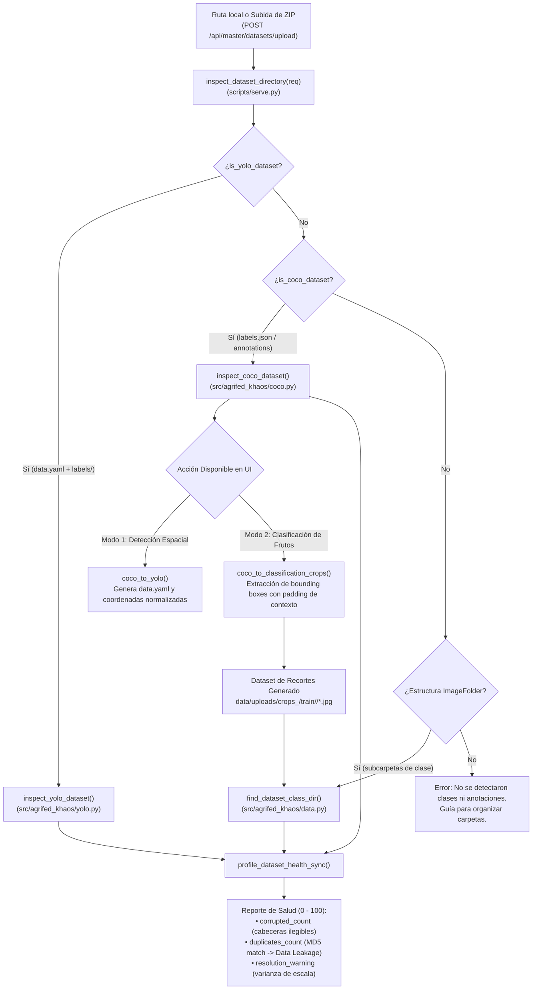
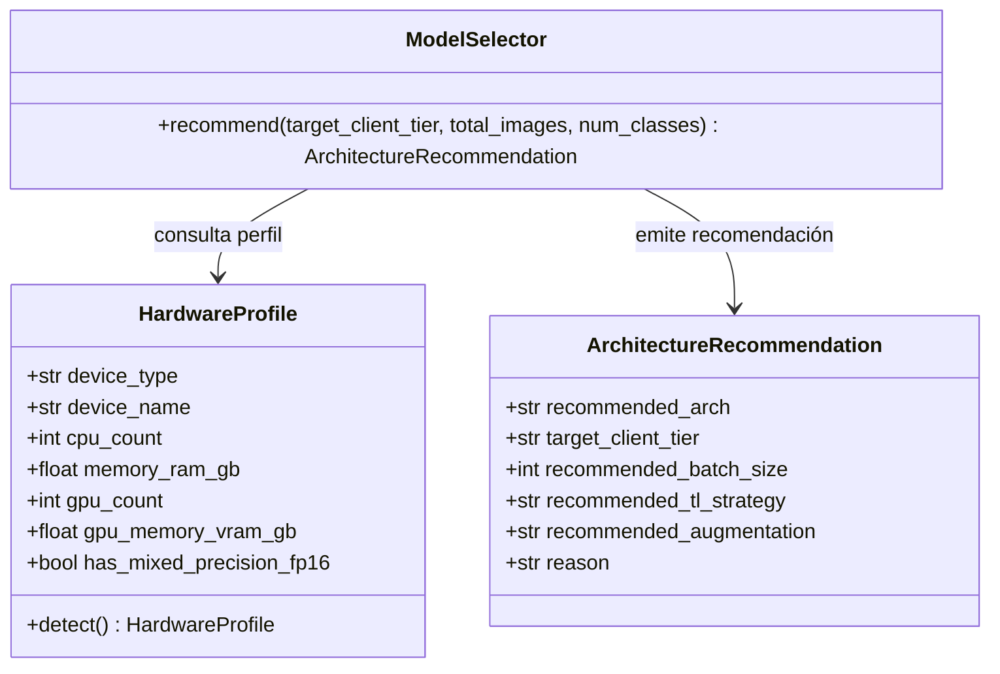
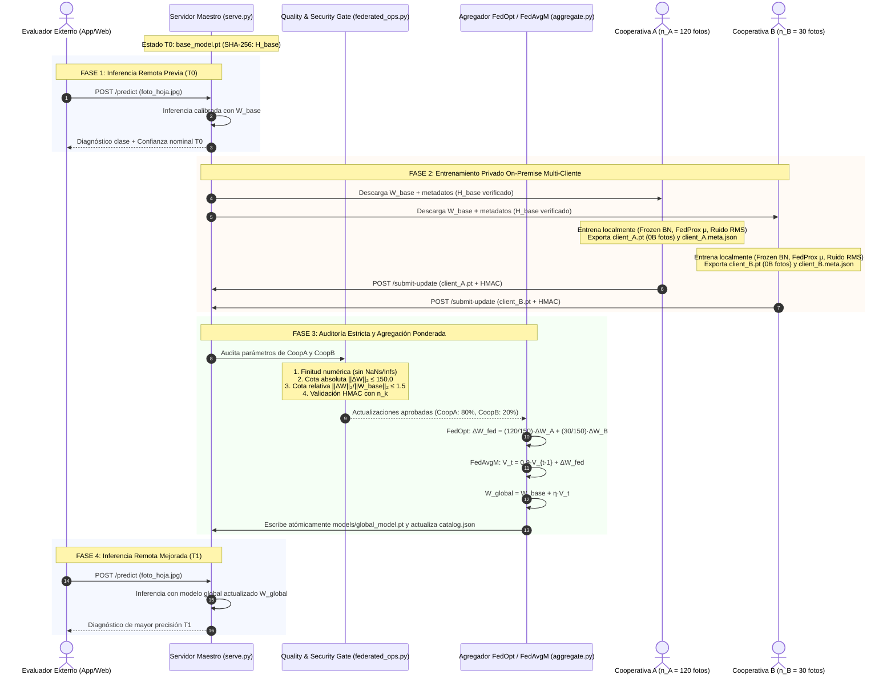
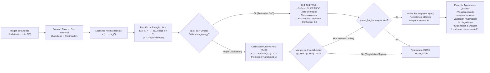

# Arquitectura del Sistema: AgriFed-KHAOS

> Versión en español. English version available in [docs/architecture.en.md](architecture.en.md).

Documento de especificación técnica, topología y decisiones arquitectónicas de **AgriFed-KHAOS**, framework modular de Aprendizaje Federado (*Federated Learning*, FL), Visión Artificial y MLOps perimetral para el sector agroalimentario e industrial.

---

## 1. Principios de Diseño y Estándares de Ingeniería

El framework está concebido bajo estándares de ingeniería de software moderna, principios SOLID y patrones de diseño MLOps:

1. **Agnosticismo de Dominio (Domain-Agnostic Core):**  
   El núcleo algorítmico no presupone una taxonomía o cultivo particular. Opera sobre tensores visuales arbitrarios independientemente de si la tarea es patología foliar, calidad de fruto o clasificación industrial.
2. **Ingestión Universal «Zero-Config»:**  
   El usuario únicamente aporta su conjunto de datos (carpeta local o archivo comprimido `.ZIP`). El subsistema de ingestión deduce automáticamente el formato (`ImageFolder`, `COCO JSON`, `Ultralytics YOLO`), analiza la salud del dataset y recomienda la arquitectura óptima.
3. **Patrón Adaptador y Desacoplamiento (OCP & DIP):**  
   La abstracción [`BaseFLWrapper`](../src/agrifed_khaos/wrappers.py) desacopla los runtimes de comunicación federada (tensores NumPy / Flower) de los frameworks subyacentes de deep learning (PyTorch, Timm, Ultralytics YOLO).
4. **Contrato de Cero Fuga de Datos (Zero Data Leakage):**  
   Las imágenes en bruto y etiquetas privadas jamás abandonan la infraestructura local de las cooperativas o nodos perimetrales. La red solo transporta parámetros matemáticos ($\Delta W$) auditados y firmados criptográficamente.
5. **Auditoría Estricta y Resiliencia Bizantina:**  
   Ninguna actualización de cliente se fusiona en el modelo global sin superar compuertas deterministas de integridad de esquema, finitud numérica, cotas de divergencia L2 y autenticación HMAC.
6. **Bucle Activo de Validación Experta (Human-In-The-Loop / HITL):**  
   Muestras de alta incertidumbre o inferencias anómalas (detectadas por el guardarraíl de energía libre OoD) son capturadas en caliente para certificación por agrónomos especialistas y reentrenamiento federado.

---

## 2. Diagrama del Flujo General del Sistema

El siguiente diagrama presenta la visión holística de AgriFed-KHAOS, desde la ingesta de datos hasta el despliegue federado y la validación en campo:

```mermaid
flowchart TD
    subgraph S1 ["1. INGESTIÓN Y PERFILADO UNIVERSAL (Zero-Config)"]
        RawData["Dataset de Entrada (Directorio o .ZIP)"] --> Inspector["Universal Dataset Inspector\n(scripts/serve.py + src/agrifed_khaos/coco.py)"]
        Inspector --> Discrim{"Discriminador Heurístico"}
        Discrim -- "labels.json / instances_*.json" --> COCO_Mod["COCO Parser Engine\n(src/agrifed_khaos/coco.py)"]
        Discrim -- "data.yaml + images/ + labels/" --> YOLO_Mod["YOLO Parser Engine\n(src/agrifed_khaos/yolo.py)"]
        Discrim -- "Subdirectorios por clase" --> Class_Mod["ImageFolder Classifier Engine\n(src/agrifed_khaos/data.py)"]
        
        COCO_Mod --> HealthCheck["Health & Integrity Profiler\n• Ficheros corruptos\n• Duplicados exactos MD5\n• Varianza de resolución"]
        YOLO_Mod --> HealthCheck
        Class_Mod --> HealthCheck
    end

    subgraph S2 ["2. DESPACHO ESTRATÉGICO Y AUTO-FL"]
        HealthCheck --> Strategy{"Estrategia Seleccionada"}
        Strategy -- "Detección Espacial Directa" --> Prep_Det["Preparación YOLO / Bounding Boxes"]
        Strategy -- "Auto-Crop para Clasificación" --> AutoCrop["Auto-Crop Engine\n(Recorte de parches con padding de contexto)"]
        Strategy -- "Clasificación Directa" --> Prep_Class["Estructura ImageFolder Canónica"]

        AutoCrop --> Prep_Class

        Prep_Det --> SelectorDet["ModelSelector (Detección)\n• Edge CPU: SSDLite MobileNetV3 / YOLOv11n\n• Server GPU: Faster R-CNN"]
        Prep_Class --> SelectorClass["ModelSelector (Clasificación)\n• cpu-low: MobileNetV3 / ResNet-18\n• cpu-high: EfficientNet-B0\n• gpu: EfficientNet-V2-S / ConvNeXt"]
    end

    subgraph S3 ["3. ENTRENAMIENTO Y ORQUESTACIÓN FEDERADA"]
        SelectorClass --> BaseTrain["Base Model Trainer (scripts/train_base.py)\n• Frozen BN Statistics\n• Balanced Cross-Entropy / Focal Loss\n• Checkpoint Bundle Autocontenido (.pt)"]
        SelectorDet --> BaseTrainDet["Detection Trainer (scripts/train_detection.py)\n• CIoU / GIoU Box Loss\n• Evaluación mAP@50 / mAP@50:95"]

        BaseTrain --> MasterOrch["Master Host Orchestrator\nmodels/catalog.json + models/metadata.json"]
        BaseTrainDet --> MasterOrch

        MasterOrch -->|"Distribución W_base (SHA-256)"| Clients["Nodos Perimetrales (K Cooperativas)\nscripts/client_trainer.py\n• Regularización Proximal FedProx (μ)\n• Perturbación RMS / Ruido Gaussiano\n• Exportación ΔW (0 Bytes de imágenes)"]

        Clients -->|"Actualizaciones ΔW + HMAC"| SecGate["Quality & Security Gate\n• Finitud Numérica (Sin NaNs/Infs)\n• Cota L2 Absoluta ||ΔW||₂ ≤ τ\n• Cota L2 Relativa ||ΔW||₂/||W_base||₂ ≤ τ_rel\n• HMAC-SHA256 autenticando num_samples"]

        SecGate --> Aggregator["Agregador Ponderado FedOpt + FedAvgM\nΔW_fed = Σ (n_k / N) · ΔW_k\nV_t = β · V_{t-1} + ΔW_fed\nW_global = W_base + η · V_t"]
        Aggregator --> GlobalModel["Modelo Global Actualizado\nmodels/global_model.pt"]
    end

    subgraph S4 ["4. SERVICIO DE INFERENCIA Y VALIDACIÓN EXPERTA (HITL)"]
        GlobalModel --> Serving["REST Inference Engine (scripts/serve.py)\n• GET /health\n• POST /predict (Individual)\n• POST /api/predict/batch (Lotes ZIP)"]

        Serving --> Guardrail{"Zero-Leakage OoD Guardrail\n(Energía Libre E(x; T))"}
        Guardrail -- "In-Distribution (Energía ≤ τ)" --> OutputPred["Inferencia Calibrada OvR\n• Probabilidades reescaladas\n• Visualización Bounding Boxes\n• Mapas de calor Grad-CAM"]
        Guardrail -- "Fuera de Distribución / Anómalo" --> OoDAlert["Bandera OoD Anomaly\nSoftmax suprimido para fiabilidad"]

        OutputPred --> HITLQueue["HITL Active Learning Queue (src/agrifed_khaos/hitl.py)\n• Encolado atómico multihilo (enqueue_sync)\n• Muestreo por incertidumbre (Margin Sampling)"]
        OoDAlert --> HITLQueue

        HITLQueue --> ExpertUI["Panel de Agrónomos (/expert)\n• Certificación de patologías\n• Corrección de etiquetas para la siguiente ronda FL"]
    end
```



---

## 3. Desglose Detallado de Subsistemas

---

### Subsistema 1: Ingestión Universal, Detección de Formatos y Diagnóstico de Salud

El subsistema de ingestión permite que usuarios sin conocimientos profundos de formatos de visión por computador suban cualquier estructura y el sistema determine el pipeline adecuado.



#### Especificación de Capacidades:
1. **Detección Automática COCO (`src/agrifed_khaos/coco.py`):**
   * Inspecciona recursivamente hasta profundidad 3 buscando descriptores JSON (`labels.json`, `instances_*.json`, `annotations.json`).
   * Valida firmas JSON (`categories`, `images`, `annotations`).
   * Resuelve automáticamente directorios gemelos de imágenes (`images/`, carpetas por split o imágenes adyacentes).
2. **Motor de Auto-Recortes (`coco_to_classification_crops`):**
   * Extrae instancias individuales de cada fruto o patología aplicando un margen de contexto configurable ($\text{padding} = 5\%$).
   * Descarta artefactos con resolución inferior a un umbral de ruido ($\text{min\_box\_size} \ge 24\text{ px}$).
   * Clasifica los recortes resultantes en la estructura canónica `ImageFolder` para que cualquier clasificador (ResNet, EfficientNet) pueda entrenarse de inmediato.
3. **Control Anti-Data-Leakage:**
   * Calcula hashes binarios MD5 en bloques de 64 KB para identificar imágenes duplicadas entre las particiones de entrenamiento y test antes de iniciar el ciclo FL.

---

### Subsistema 2: Selección Autónoma de Arquitectura (Auto-FL Aware)

En entornos de Aprendizaje Federado, el servidor maestro puede disponer de aceleración por GPU, pero las cooperativas agrícolas participantes suelen operar sobre CPUs estándar o hardware perimetral de bajo coste. [`ModelSelector`](../src/agrifed_khaos/hardware.py) determina la arquitectura óptima analizando conjuntamente el volumen de datos y el perfil del hardware cliente:



#### Matriz de Decisión Arquitectónica:

| Nivel Cliente (`target_client_tier`) | Tarea | Volumen Muestral ($N$) | Arquitectura Recomendada | Estrategia de Transfer Learning | Aumento de Datos |
|---|---|---|---|---|---|
| **`cpu-low`** | Clasificación | $N < 1.000$ | `resnet18` (~11.7M) | Linear Probing (`head_only`) | Básico (Flips + Crops) |
| **`cpu-low`** | Clasificación | $1.000 \le N \le 5.000$ | `mobilenet_v3_large` (~5.4M) | Fine-Tuning Parcial (`partial`) | Básico |
| **`cpu-low`** | Detección | Cualquier $N$ | `ssdlite320_mobilenet_v3_large` | Backbone congelado | Multi-Scale Rescale |
| **`cpu-high`** | Clasificación | $1.000 \le N \le 5.000$ | `efficientnet_b0` (~5.3M) | Fine-Tuning Parcial (`partial`) | Básico |
| **`cpu-high`** | Detección | Cualquier $N$ | `yolo11n` (~2.6M) | Fine-Tuning de Cabezas | Mosaic + HSV Augment |
| **`gpu`** | Clasificación | $N > 5.000$ | `efficientnet_v2_s` (~21.5M) | Fine-Tuning Parcial (`partial`) | `RandAugment` Agresivo |
| **`gpu`** | Detección | $N > 5.000$ | `fasterrcnn_resnet50_fpn_v2` | FPN + RoI Heads | Multi-Scale Heavy |

---

### Subsistema 3: Ciclo de Vida Federado, Compuertas de Seguridad y Agregación

El ciclo de entrenamiento federado garantiza el aislamiento total de los datos físicos mediante un protocolo de cuatro fases con auditoría determinista:



#### Fórmulas Matemáticas Clave del Agregador:

1. **Regularización Proximal Local (FedProx):**
   $$
   \mathcal{L}_{\text{prox}}(W; W_{\text{base}}) = \mathcal{L}_{\text{CE}}(W; X, Y) + \frac{\mu}{2} \sum_{l=1}^{L} \| W_l - W_{l,\text{base}} \|_2^2
   $$
2. **Cota de Divergencia Relativa (Relative L2 Gate):**
   $$
   \delta_{\text{rel}} = \frac{\|\Delta W\|_2}{\max(\|W_{\text{base}}\|_2, 10^{-8})} \le \tau_{\text{rel}} \quad (\text{por defecto } \tau_{\text{rel}} = 1.5)
   $$
3. **Agregación Multi-Cliente con Momento del Servidor (FedAvgM):**
   $$
   \Delta W_{\text{fed}} = \sum_{k=1}^{K} \frac{n_k}{N} (W_k - W_{\text{base}})
   $$
   $$
   V_t = \beta V_{t-1} + \Delta W_{\text{fed}}, \quad W_{\text{global}} = W_{\text{base}} + \eta V_t
   $$

---

### Subsistema 4: Inferencia, Guardarraíl OoD y Bucle Humano (HITL)

Para evitar que el modelo emita diagnósticos con confianza artificialmente inflada ante imágenes anómalas (hojas de especies no contempladas, dedos, insectos no reconocidos), el motor de inferencia desacopla el cálculo mediante un **Guardarraíl de Energía Libre**:



---

## 4. Estructura de Directorios del Repositorio

La organización de módulos refleja la separación limpia entre infraestructura, algoritmos federados, plantillas web y pruebas:

```text
AgriFed-khaos/
├── compose.yaml                      # Orquestación Docker multi-nodo
├── pyproject.toml                    # Dependencias estandarizadas PEP 621
├── scripts/                          # Entrypoints y herramientas CLI ejecutables
│   ├── aggregate.py                  # Agregador FedOpt/FedProx multi-cliente ponderado
│   ├── client_trainer.py             # Entrenador on-premise perimetral para cooperativas
│   ├── evaluate.py                   # Evaluador global, matrices de confusión y calibración OvR
│   ├── serve.py                      # Servidor FastAPI REST (puerto 8000), APIs e inferencia
│   └── train_base.py                 # Entrenador base agnóstico con auto-selección de hardware
├── src/agrifed_khaos/                # Código fuente del paquete principal
│   ├── catalog.py                    # Catálogo dinámico de modelos lógicos y versionado
│   ├── coco.py                       # Parser COCO JSON, detector de bounding boxes y auto-crops
│   ├── crypto.py                     # Firmas HMAC-SHA256 y digests de tensores
│   ├── data.py                       # Carga de datos, split zero-leakage y preprocesado
│   ├── federated_ops.py              # Auditoría estricta de parámetros y contratos de seguridad
│   ├── hardware.py                   # Detección de hardware perimetral y ModelSelector
│   ├── hitl.py                       # Gestor de colas Human-In-The-Loop con escritura atómica
│   ├── models.py                     # Fábrica de arquitecturas vision (Timm, Torchvision, Grad-CAM)
│   ├── quality.py                    # Filtros de calidad fotográfica (Laplaciano, desenfoque)
│   ├── static/                       # Activos estáticos, diseño Tailwind y branding oficial
│   ├── templates/                    # Vistas HTML5 reactivas (Jinja2)
│   │   ├── client.html               # Portal agnóstico de inferencia para agricultores
│   │   ├── expert.html               # Panel HITL de revisión agronómica para especialistas
│   │   ├── master.html               # Panel MLOps de orquestación, entrenamiento y linaje
│   │   ├── model_create.html         # Asistente de creación de modelo y perfilado de dataset
│   │   └── model_detail.html         # Panel de diagnóstico detallado, Grad-CAM y lote ZIP
│   ├── wrappers.py                   # Adaptadores BaseFLWrapper y TorchModuleWrapper
│   └── yolo.py                       # Parser y DataLoader de Ultralytics YOLOv8/YOLOv11
├── tests/                            # Batería exhaustiva de pruebas unitarias y de integración
│   ├── test_audit_corrections.py     # Pruebas de compuertas L2 y finitud numérica
│   ├── test_batch_zip_inference.py   # Pruebas de inferencia por lote ZIP y persistencia HITL
│   ├── test_coco_dataset_and_crops.py# Pruebas de parser COCO, conversión YOLO y auto-recortes
│   ├── test_federated_security_lifecycle.py # Ciclo de vida federado y autenticidad HMAC
│   └── test_hardware_and_guardrail.py# Pruebas del guardarraíl de energía y ModelSelector
└── docs/                             # Documentación técnica y manuales de arquitectura
    ├── architecture.md               # Este documento
    └── user_guide.md                 # Guía paso a paso de uso
```

---

## 5. Modelo de Amenazas y Límites de Seguridad (Threat Model)

Para mantener rigor y transparencia técnica, se especifican explícitamente las garantías formales cubiertas y los límites fuera del alcance:

### A. Garantías Cubiertas (In-Scope)
* **Cero Fuga de Muestras Multimedia:** Las imágenes físicas y etiquetas de entrenamiento jamás abandonan la infraestructura perimetral del cliente (`0 bytes` de datos multimedia transferidos).
* **Superficie de Exposición Reducida (Head-Only):** En el ajuste de cabeza (`--head-only`), el 100% del extractor convolucional permanece inmutable en el cliente; únicamente se exporta la matriz lineal de clasificación ($\approx 18\text{ KB}$), bloqueando ataques de inversión sobre activaciones intermedias.
* **Perturbación Heurística Local:** El recorte L2 ($C_{\text{clip}}$) y la inyección gaussiana adaptativa ($\sigma \cdot \text{RMS}$) distorsionan las actualizaciones locales antes de salir del nodo perimetral.
* **Integridad Criptográfica Determinista:** Los digests SHA-256 en memoria y la firma HMAC-SHA256 certifican que los parámetros no han sido manipulados en tránsito ni inyectados por actores no autorizados.

### B. Limitaciones Conocidas y Fuera de Alcance (Out-of-Scope)
1. **Ausencia de Secure Multi-Party Computation (SecAgg):**  
   El servidor maestro recibe las actualizaciones de pesos $\Delta W_k$ de forma individual antes de agregarlas. Por tanto, el servidor se asume **autorizado y confiable**. No se implementa agregación homomórfica distribuida sin conocimiento previo.
2. **Sin Cota Analítica $(\epsilon, \delta)$ de Privacidad Diferencial:**  
   La perturbación mediante ruido gaussiano constituye una mitigación empírica frente a inversión de gradientes; no incluye un contador formal de momentos Rényi DP calibrado con el tamaño del dataset y ratio de muestreo.
3. **Transporte Seguro (TLS/HTTPS Obligatorio en Producción):**  
   En despliegues reales fuera de redes locales aisladas, el servicio debe ejecutarse obligatoriamente bajo HTTPS mediante certificados TLS nativos en FastAPI o mediante un proxy inverso (Nginx, Caddy o Traefik).
