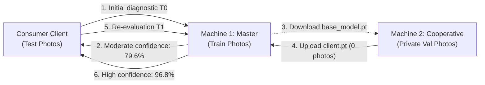

# End-to-End Operational Workflow: 2-Machine Real Business Case

> English documentation. Versión en español disponible en [docs/workflow.md](workflow.md).

This document details the real empirical validation of **AgriFed-KHAOS** conducted using the official open olive leaf pathology dataset (*Olea europaea*):  
[https://khaos.uma.es/isidros-opendata/dataset/enfermedades-hoja-olivo](https://khaos.uma.es/isidros-opendata/dataset/enfermedades-hoja-olivo) (`EnfermedadesHoja_v1.0`).

It demonstrates how an agricultural cooperative trains over its confidential on-premise data on its physical host without transmitting a single image to the central orchestrator, achieving a **+8.12% accuracy gain** and halving test loss on the global model.

---

## 1. Business Scenario and Physical Data Partitioning

In real-world production deployments, each collaborating cooperative or enterprise operates in complete isolation with its own private image repository collected locally across its farms and facilities, while the orchestrator maintains its own institutional data.

To ensure **immediate deterministic reproducibility** across this walkthrough without requiring access to disparate private databases or proprietary field credentials, we partition the official open benchmark `EnfermedadesHoja_v1.0` (ISIDROS-OpenData / Khaos research group, University of Málaga) simulating this exact two-machine ecosystem. Before training, split the master's original `train/` into two disjoint subsets: `train_master/` and `val_master/`. When source identifiers exist, split by source unit (e.g. plant, leaf, farm, or capture session), not just by file, to reduce leakage among correlated images.

```text
Official Dataset EnfermedadesHoja_v1.0 (12,157 images, 9 classes)
├── train_master/ ──► Machine 1: baseline model training
├── val_master/   ──► Machine 1: held-out calibration, never used for training or sent to the client
├── val/ (1,178 photos) ──► Machine 2: simulated private cooperative silo
└── test/  (1,170 photos) ──► Reserved for Consumer Client (Independent T0 vs T1 Auditing)
```

1. **Machine 1 (Master Orchestrator):**
   - Holds `train_master/` and `val_master/`, both derived from its own original `train/` partition.
   - Trains exclusively on `train_master/`, calibrates decision thresholds on `val_master/`, and hosts the REST microservice.
   - Never shares `val_master/` with the client or uses it for training.
   - Possesses zero physical or network access to raw imagery on Machine 2.
2. **Machine 2 (Collaborator Client / Edge Cooperative):**
   - Holds the `val/` partition locally, acting as its confidential field silo.
   - Possesses zero access to images in `train/`.
   - Under GDPR and commercial trade-secret compliance, **zero raw images are permitted to leave the premises**.
3. **Consumer Client (Field Agronomist / Mobile App):**
   - Holds uninspected field samples from `test/`.
   - Performs remote REST queries before ($T_0$) and after ($T_1$) federated collaboration.

---

## 2. High-Level Visual Architecture



---

## 3. Step-by-Step Execution

<details open>
<summary><strong>Step 0: Setup from Scratch (Repository, Official Dataset & Docker)</strong></summary>

To guarantee deterministic reproducibility on any clean machine or physical server:

#### 1. Clone the repository and configure Docker:
```bash
# On the host system (outside container):
git clone https://github.com/Diegodepab/AgriFed-khaos.git
cd AgriFed-khaos
cp .env.example .env
make up
```

#### 2. Position the official dataset within the repository:
Docker mounts only the project directory (`.:/workspace`). Therefore, the `dataset/` directory must reside inside `AgriFed-khaos/` so scripts inside the container can locate the files.

<details>
<summary><strong>Option A: If downloading the official ZIP archive directly</strong></summary>

```bash
# On the host, inside AgriFed-khaos:
# Download or place EnfermedadesHoja_v1.0.zip
unzip EnfermedadesHoja_v1.0.zip
# Move the inner dataset folder to the project root:
mv EnfermedadesHoja_v1.0/dataset ./dataset
```
</details>

<details>
<summary><strong>Option B: If you already have the dataset unzipped in an external directory (e.g., <code>../enfermedadeshoja_v1.0</code>)</strong></summary>

```bash
# On the host, inside AgriFed-khaos:
# Copy the dataset directory so it is included within the Docker volume:
cp -r ../enfermedadeshoja_v1.0/EnfermedadesHoja_v1.0 ./dataset
```
*(Note: Do not use relative symlinks pointing to `../` because Docker cannot resolve external host paths from within `/workspace`).*
</details>

#### 3. Verify directory partitions:
Verify that `dataset/` contains all three standard partitions:
```bash
ls -l dataset/
# Must display:
# train_master/ (part of original train) -> Machine 1 training
# val_master/   (held out from original train, disjoint) -> Machine 1 calibration
# val/          (1,178 photos) -> Machine 2 simulated private silo
# test/   (1,170 photos across class subdirectories) -> Assigned to Independent Auditing
```
Create `train_master/` and `val_master/` before training by moving or copying complete source groups from the original `train/`. Do not retain the same images in both directories. In production, replace `val/` with the client's own private partition; never use `val_master/` as federated client data.

#### 4. Enter the Docker container:
```bash
# Always execute from the repository root (where compose.yaml resides):
cd ~/temporal/AgriFed-khaos  # or the path to your cloned AgriFed-khaos directory
docker compose exec agrifed bash

# Or alternatively, from any directory via native docker exec:
# docker exec -it agrifed-khaos-agrifed-1 bash
```
</details>

<details open>
<summary><strong>Phase A: On Machine 1 (Master Server - Baseline Model & T0 Service)</strong></summary>

1. **Train the Baseline Model:**
   The master trains exclusively on `train_master/`; `val_master/` remains held out:
   ```bash
   python scripts/train_base.py --data-dir dataset/train_master
   ```
   *Auto-FL selects `resnet18` (~42.7 MB) and serializes the self-contained bundle `models/base_model.pt`.*

   <details>
   <summary>View Auto-FL options and behavior</summary>

   - `--arch {auto, resnet18, resnet50, mobilenetv4_conv_small}`: Force a specific architecture (default: `auto`).
   - `--epochs <int>`: Initial training epochs (default: 3).
   - Generates immutable lineage in `models/metadata.json` with the official SHA-256 digest.
   </details>

2. **Initial One-vs-Rest Threshold Calibration (T0):**
   To optimize the decision boundary against class imbalance before serving predictions, the orchestrator computes thresholds $\tau_c^*$ on `val_master/`, held out from its own data and disjoint from `train_master/`:
   ```bash
   python scripts/evaluate.py \
     --model models/base_model.pt \
     --data-dir dataset/val_master \
     --calibrate-threshold
   ```
   *(Methodological note: `val_master/` belongs exclusively to the master. The client trains on its independent private partition (`val/` in this simulation); no image may overlap with `val_master/`. In production, calibrate on a held-out subset owned by the master, never on client data or training images).*
   *Injects optimal thresholds directly into `metadata["calibrated_thresholds"]` within the `.pt` bundle.*

3. **Launch REST Diagnostic Service:**
   ```bash
   python scripts/serve.py
   ```
   *Listens on `http://0.0.0.0:8000` with automatic dynamic model reloading, endpoints for inference (`/predict`), public model weights distribution (`/download-model`), and secure manifest-verified parameter ingestion (`/submit-update`).*
</details>

<details open>
<summary><strong>Phase B: Consumer Client (Pre-Federated Inference at T0)</strong></summary>

The field technician selects a genuine leaf sample exhibiting peacock spot symptoms (`dataset/test/repilo/`):

```bash
# Select a real test sample:
SAMPLE=$(ls dataset/test/repilo/*.jpg | head -n 1)

# Query diagnostic prediction from master server:
curl -X POST http://<MACHINE_1_IP>:8000/predict -F "file=@$SAMPLE"
```

**Diagnostic Response at T0:**
```json
{
  "predicted_class": "repilo",
  "confidence": 0.7962,
  "probabilities": {
    "repilo": 0.7962,
    "sano": 0.1245,
    "antracnosis": 0.0793
  },
  "threshold_applied": "calibrated",
  "filename": "muestra_campo.jpg"
}
```
*Diagnosis is correct but displays moderate confidence (79.62%) with residual probability allocated to healthy tissue and anthracnose.*
</details>

<details open>
<summary><strong>Phase C: On Machine 2 (Edge Cooperative - Full From-Scratch Workflow)</strong></summary>

The collaborating cooperative starts on a clean workstation without previous code and trains over its 1,178 private photos in `val/`:

<details>
<summary><strong>Machine 2 setup instructions from scratch</strong></summary>

```bash
# 1. Clone official repository and initialize Docker:
git clone https://github.com/Diegodepab/AgriFed-khaos.git
cd AgriFed-khaos
cp .env.example .env
make up

# 2. Place private local photos into dataset/val inside the cloned directory:
# This is client-local data, not the server's dataset/val_master.
# In production, use the cooperative's private training partition.
# (in this empirical study, the 1,178 val/ images)

# 3. Enter container:
docker compose exec agrifed bash
```
</details>

1. **Download Official Baseline Model Weights:**
   Retrieves the baseline bundle published by the master server via HTTP:
   ```bash
   mkdir -p models
   curl -o models/base_model.pt http://<MACHINE_1_IP>:8000/download-model
   ```

2. **Execute Local Private Training (`--head-only`):**
   ```bash
   python scripts/client_trainer.py \
     --data-dir dataset/val \
     --weights-in models/base_model.pt \
     --weights-out models/client_parameters.pt \
     --head-only \
     --server-url http://<MACHINE_1_IP>:8000 \
     --client-id coop_sevilla
   ```

3. **Technical Privacy & Bandwidth Guarantees:**
   - **Head-Only Fine-Tuning:** The convolutional feature backbone (`resnet18`) remains completely frozen; only the final linear classifier parameters (`fc.weight`, `fc.bias`) are updated.
   - **Automated Delivery with Manifest:** `--server-url` transmits the parameter file and manifest as multipart; the server validates SHA-256 and verifies HMAC when `AGRIFED_HMAC_KEY` is configured. Ingestion executes as an atomic transaction via per-client asynchronous locks (`asyncio.Lock`), committing the indivisible file pair to an immutable directory `models/client_updates/updates/{client_id}/{stamp}/`. Configure either `AGRIFED_AUTH_TOKEN` or `AGRIFED_HMAC_KEY` on server and client. Deploy behind HTTPS (natively via `--ssl-*` or an HTTPS reverse proxy) for all connections outside a trusted local network. For air-gapped setups, transfer both files through a secure channel.
   - **0 bytes of imagery leave Machine 2.**
</details>

<details open>
<summary><strong>Phase D: On Machine 1 (Security Auditing, Head-Only Aggregation & T1 Re-Calibration)</strong></summary>

The master server receives `coop_sevilla_parameters.pt` alongside `coop_sevilla_parameters.meta.json`, validates security gates, applies `FedAvgM` server momentum, and re-calibrates decision thresholds:

1. **Secure Federated Aggregation with Server Momentum:**
   ```bash
   python scripts/aggregate.py \
     --base-model models/base_model.pt \
     --client-weights models/client_updates/coop_sevilla_parameters.pt \
     --output models/global_model.pt
   ```

   *(Note on multi-round lineage: In Round 1, `--base-model` targets `models/base_model.pt`. For subsequent federated rounds (Round 2+), both client training (`--weights-in`) and the aggregator (`--base-model`) should point to `models/global_model.pt`, maintaining continuous auditable lineage across rounds).*

   *Internal Gate Verification:*
   - **Lineage Gate:** Confirms `base_model_sha256` matches the exact checkpoint selected by `--base-model` for that round.
   - **ParameterValidator (`head_only`):** Verifies the uploaded payload contains **strictly and exclusively linear classifier parameters** (`fc.*`), ensuring zero spurious convolutional keys, absolute finiteness (no `NaN`/`Inf`), and L2 divergence bounds ($\|\Delta W_{\text{head}}\|_2 = 12.00 \le 150.0$).
   - **Targeted FedAvgM Momentum:** Server momentum ($\beta = 0.9$ default) is calculated and applied **strictly over the classifier head weights**.
   - **Backbone & BatchNorm Invariance:** The entire convolutional feature extraction backbone and batch normalization statistics (`BatchNorm.running_mean`, `BatchNorm.running_var`) remain **100% frozen, invariant, and identical to the original baseline model**.

2. **Rapid One-vs-Rest Re-Calibration (Post-Aggregation):**
   Because weight aggregation shifted the classifier's logit space, the initial $T_0$ calibration is obsolete for the updated parameters. The master executes an automated re-calibration on its validation split:
   ```bash
   python scripts/evaluate.py \
     --model models/global_model.pt \
     --data-dir dataset/val_master \
     --calibrate-threshold
   ```
   *Calculates fresh optimal thresholds $\tau_c^*$ on the updated decision boundary using only the master's `val_master/` (disjoint from both `train_master/` and the client's private silo), then updates `models/global_model.pt` directly.*

3. **Dynamic Hot-Reload in REST Service:**
   The service in `scripts/serve.py` automatically detects when `models/global_model.pt` is created or updated on disk and hot-reloads the weights and calibrated thresholds on the next incoming request (or triggered manually via `curl -X POST http://localhost:8000/reload-model`). The indicator `"threshold_applied": "calibrated"` now reflects genuine calibrated probabilities on the updated model.
</details>

<details open>
<summary><strong>Phase E: Consumer Client (Post-Federation Inference at T1)</strong></summary>

The field technician queries the API with the identical sample image:

```bash
curl -X POST http://<MACHINE_1_IP>:8000/predict -F "file=@$SAMPLE"
```

**Diagnostic Response at T1 (Post-Federation):**
```json
{
  "predicted_class": "repilo",
  "confidence": 0.9687,
  "probabilities": {
    "repilo": 0.9687,
    "sano": 0.0211,
    "antracnosis": 0.0102
  },
  "threshold_applied": "calibrated",
  "filename": "muestra_campo.jpg"
}
```
*Confidence increases by **+17.25%** (from 79.62% to 96.87%), resolving uncertainty through collaborative edge training.*
</details>

---

## 4. Certified Quantitative Results (Test Split: 1,170 images)

Global evaluation executed on the independent test set (1,170 images never observed during training by either node):

| Metric | Baseline Model ($T_0$) | Federated Global Model ($T_1$) | Net Impact ($\Delta$) | Status |
| :--- | :---: | :---: | :---: | :--- |
| **Global Accuracy** | `74.44%` | **`82.56%`** | **`+8.12%`** | Statistically Significant Gain |
| **Test Loss (Cross-Entropy)** | `0.8611` | **`0.4333`** | **`-0.4278`** | Loss Reduced by 49.7% |
| **Macro F1-Score** | `64.15%` | **`70.60%`** | **`+6.45%`** | Class Separability Enhanced |
| **Confidence on Field Sample (Repilo)** | `79.62%` | **`96.87%`** | **`+17.25%`** | High Diagnostic Certainty |
| **Raw Imagery Transferred by Cooperative** | `0 bytes` | `0 bytes` | **`0 B`** | Complete Privacy (Zero Leakage) |
| **Perturbation Norm ($\|\Delta W_{\text{head}}\|_2$)** | — | `12.0091` | (Bound $\le 150.0$) | Approved by Security Gate |

---

## 5. Diagnostic Artifacts & Explainability

To audit and present findings to leadership and stakeholders:

* **Full Evaluation & Calibration:**
  ```bash
  python scripts/evaluate.py --data-dir dataset/test --out-dir reports/
  ```
* **Grad-CAM Attention Heatmaps:** Overlays heatmaps to verify the neural network focuses on genuine leaf lesions rather than background artifacts:
  ```bash
  python scripts/evaluate.py --image field_sample.jpg --out-dir reports/
  ```

