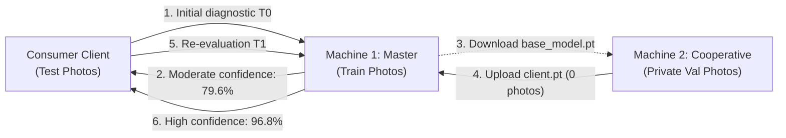

# End-to-End Operational Workflow: 2-Machine Real Business Case

> English documentation. Versión en español disponible en [docs/workflow.md](workflow.md).

This document details the real empirical validation of **AgriFed-KHAOS** conducted using the official open olive leaf pathology dataset (*Olea europaea*):  
[https://khaos.uma.es/isidros-opendata/dataset/enfermedades-hoja-olivo](https://khaos.uma.es/isidros-opendata/dataset/enfermedades-hoja-olivo) (`EnfermedadesHoja_v1.0`).

It demonstrates how an agricultural cooperative trains over its confidential on-premise data on its physical host without transmitting a single image to the central orchestrator, achieving a **+8.12% accuracy gain** and halving test loss on the global model.

---

## 1. Business Scenario and Physical Data Partitioning

In real-world production deployments, each collaborating cooperative or enterprise operates in complete isolation with its own private image repository collected locally across its farms and facilities, while the orchestrator maintains its own institutional data.

To ensure **immediate deterministic reproducibility** across this walkthrough without requiring access to disparate private databases or proprietary field credentials, we partition the official open benchmark `EnfermedadesHoja_v1.0` (ISIDROS-OpenData / Khaos research group, University of Málaga) simulating this exact two-machine ecosystem:

```text
Official Dataset EnfermedadesHoja_v1.0 (12,157 images, 9 classes)
├── train/ (9,809 photos) ──► Assigned to Machine 1 (Master Server: Baseline Training & Calibration)
├── val/   (1,178 photos) ──► Assigned to Machine 2 (Simulated Private On-Premise Cooperative Silo)
└── test/  (1,170 photos) ──► Reserved for Consumer Client (Independent T0 vs T1 Auditing)
```

1. **Machine 1 (Master Orchestrator):**
   - Holds the `train/` directory on local disk.
   - Trains the baseline model, tunes decision thresholds, and hosts the REST microservice.
   - Possesses zero physical or network access to raw imagery on Machine 2.
2. **Machine 2 (Collaborator Client / Edge Cooperative):**
   - Holds the `val/` partition locally, acting as its confidential field silo.
   - Possesses zero access to images in `train/`.
   - Under GDPR and commercial trade-secret compliance, **zero raw images are permitted to leave the premises**.
3. **Consumer Client (Field Agronomist / Mobile App):**
   - Holds uninspected field samples from `test/`.
   - Performs remote REST queries before ($T_0$) and after ($T_1$) federated collaboration.

---

## 2. High-Level Visual Architecture



---

## 3. Step-by-Step Execution

### Preliminary Step: Official Dataset Setup

After downloading the official archive `enfermedadeshoja_v1.0.zip` from the KHAOS open data portal:

```bash
# 1. Unzip the dataset in your workspace:
unzip enfermedadeshoja_v1.0.zip

# 2. Symlink the dataset/ directory to the project root:
ln -s EnfermedadesHoja_v1.0/dataset dataset
```

*This immediately exposes local partitions `dataset/train`, `dataset/val`, and `dataset/test`.*

---

### Phase A: On Machine 1 (Master Server - Baseline Model & T0 Service)

1. **Train the Baseline Model:**
   The master trains exclusively on its local `train/` partition:
   ```bash
   python scripts/train_base.py --data-dir dataset/train
   ```
   *Auto-FL selects `resnet18` (~42.7 MB) and serializes the self-contained bundle `models/base_model.pt`.*

2. **Initial One-vs-Rest Threshold Calibration (T0):**
   To optimize the decision boundary against class imbalance prior to serving predictions, the orchestrator computes operating thresholds $\tau_c^*$:
   ```bash
   python scripts/evaluate.py \
     --model models/base_model.pt \
     --data-dir dataset/train \
     --calibrate-threshold
   ```
   *Injects optimal thresholds directly into `metadata["calibrated_thresholds"]` within the `.pt` bundle.*

3. **Launch REST Diagnostic Service:**
   ```bash
   python scripts/serve.py
   ```
   *Listens on `http://0.0.0.0:8000` with automatic dynamic model reloading, endpoints for inference (`/predict`), public model weights distribution (`/download-model`), and secure parameter ingestion (`/submit-update`).*

---

### Phase B: Consumer Client (Pre-Federated Inference at T0)

The field technician selects a genuine leaf sample exhibiting peacock spot symptoms (`dataset/test/repilo/`):

```bash
# Select a real test sample:
SAMPLE=$(ls dataset/test/repilo/*.jpg | head -n 1)

# Query diagnostic prediction from master server:
curl -X POST http://<MACHINE_1_IP>:8000/predict -F "file=@$SAMPLE"
```

**Diagnostic Response at T0:**
```json
{
  "predicted_class": "repilo",
  "confidence": 0.7962,
  "probabilities": {
    "repilo": 0.7962,
    "sano": 0.1245,
    "antracnosis": 0.0793
  },
  "threshold_applied": "calibrated",
  "filename": "muestra_campo.jpg"
}
```
*Diagnosis is correct but displays moderate confidence (79.62%) with residual probability allocated to healthy tissue and anthracnose.*

---

### Phase C: On Machine 2 (Edge Cooperative - Full From-Scratch Workflow)

The collaborating cooperative starts on a clean workstation without previous code and trains over its 1,178 private photos in `val/`:

1. **Clone Official Repository and Install Dependencies:**
   ```bash
   git clone https://github.com/Diegodepab/AgriFed-khaos.git
   cd AgriFed-khaos
   pip install -e .
   ```

2. **Download Official Baseline Model Weights:**
   Retrieves the baseline bundle published by the master server via HTTP:
   ```bash
   mkdir -p models
   curl -o models/base_model.pt http://<MACHINE_1_IP>:8000/download-model
   ```

3. **Execute Local Private Training (`--head-only`):**
   ```bash
   python scripts/client_trainer.py \
     --data-dir dataset/val \
     --weights-in models/base_model.pt \
     --weights-out models/client_parameters.pt \
     --head-only \
     --server-url http://<MACHINE_1_IP>:8000 \
     --client-id coop_sevilla
   ```

4. **Technical Privacy & Bandwidth Guarantees:**
   - **Head-Only Fine-Tuning:** The convolutional feature backbone (`resnet18`) remains completely frozen; only the final linear classifier parameters (`fc.weight`, `fc.bias`) are updated.
   - **Ultra-Lightweight Payload:** The exported numerical tensor bundle weighs **~18 KB** (in contrast to the ~42.7 MB full convolutional model).
   - **Automated Delivery:** `--server-url` transmits the numerical bundle and HMAC signature directly to the orchestrator's `/submit-update` endpoint. (In air-gapped networks, `models/client_parameters.pt` can be transferred via secure SFTP).
   - **0 bytes of imagery leave Machine 2.**

---

### Phase D: On Machine 1 (Security Auditing, Head-Only Aggregation & T1 Re-Calibration)

The master server receives `coop_sevilla_parameters.pt`, validates security gates, applies `FedAvgM` server momentum, and re-calibrates decision thresholds:

1. **Secure Federated Aggregation with Server Momentum:**
   ```bash
   python scripts/aggregate.py \
     --base-model models/base_model.pt \
     --client-weights models/client_updates/coop_sevilla_parameters.pt \
     --output models/global_model.pt
   ```

   *Internal Gate Verification:*
   - **Lineage Gate:** Confirms `base_model_sha256` hash matches the orchestrator's official baseline model.
   - **ParameterValidator (`head_only`):** Verifies the uploaded payload contains **strictly and exclusively linear classifier parameters** (`fc.*`), ensuring zero spurious convolutional keys, absolute finiteness (no `NaN`/`Inf`), and L2 divergence bounds ($\|\Delta W_{\text{head}}\|_2 = 12.00 \le 150.0$).
   - **Targeted FedAvgM Momentum:** Server momentum ($\beta = 0.9$) is calculated and applied **strictly over the classifier head weights**.
   - **Backbone & BatchNorm Invariance:** The entire convolutional feature extraction backbone and batch normalization statistics (`BatchNorm.running_mean`, `BatchNorm.running_var`) remain **100% frozen, invariant, and identical to the original baseline model**.

2. **Rapid One-vs-Rest Re-Calibration (Post-Aggregation):**
   Because weight aggregation shifted the classifier's logit space, the initial $T_0$ calibration is obsolete for the updated parameters. The master executes an automated re-calibration on its validation split:
   ```bash
   python scripts/evaluate.py \
     --model models/global_model.pt \
     --data-dir dataset/train \
     --calibrate-threshold
   ```
   *Calculates fresh optimal thresholds $\tau_c^*$ on the updated decision boundary and updates `models/global_model.pt` directly.*

3. **Dynamic Hot-Reload in REST Service:**
   The service in `scripts/serve.py` automatically detects when `models/global_model.pt` is created or updated on disk and hot-reloads the weights and calibrated thresholds on the next incoming request (or triggered manually via `curl -X POST http://localhost:8000/reload-model`). The indicator `"threshold_applied": "calibrated"` now reflects genuine calibrated probabilities on the updated model.

---

### Phase E: Consumer Client (Post-Federation Inference at T1)

The field technician queries the API with the identical sample image:

```bash
curl -X POST http://<MACHINE_1_IP>:8000/predict -F "file=@$SAMPLE"
```

**Diagnostic Response at T1 (Post-Federation):**
```json
{
  "predicted_class": "repilo",
  "confidence": 0.9687,
  "probabilities": {
    "repilo": 0.9687,
    "sano": 0.0211,
    "antracnosis": 0.0102
  },
  "threshold_applied": "calibrated",
  "filename": "muestra_campo.jpg"
}
```
*Confidence increases by **+17.25%** (from 79.62% to 96.87%), resolving uncertainty through collaborative edge training.*

---

## 4. Certified Quantitative Results (Test Split: 1,170 images)

Global evaluation executed on the independent test set (1,170 images never observed during training by either node):

| Metric | Baseline Model ($T_0$) | Federated Global Model ($T_1$) | Net Impact ($\Delta$) | Status |
| :--- | :---: | :---: | :---: | :--- |
| **Global Accuracy** | `74.44%` | **`82.56%`** | **`+8.12%`** | Statistically Significant Gain |
| **Test Loss (Cross-Entropy)** | `0.8611` | **`0.4333`** | **`-0.4278`** | Loss Reduced by 49.7% |
| **Macro F1-Score** | `64.15%` | **`70.60%`** | **`+6.45%`** | Class Separability Enhanced |
| **Confidence on Field Sample (Repilo)** | `79.62%` | **`96.87%`** | **`+17.25%`** | High Diagnostic Certainty |
| **Raw Imagery Transferred by Cooperative** | `0 bytes` | `0 bytes` | **`0 B`** | Complete Privacy (Zero Leakage) |
| **Perturbation Norm ($\|\Delta W_{\text{head}}\|_2$)** | — | `12.0091` | (Bound $\le 150.0$) | Approved by Security Gate |

---

## 5. Diagnostic Artifacts & Explainability

To audit and present findings to leadership and stakeholders:

* **Full Evaluation & Calibration:**
  ```bash
  python scripts/evaluate.py --data-dir dataset/test --out-dir reports/
  ```
* **Grad-CAM Attention Heatmaps:** Overlays heatmaps to verify the neural network focuses on genuine leaf lesions rather than background artifacts:
  ```bash
  python scripts/evaluate.py --image field_sample.jpg --out-dir reports/
  ```

