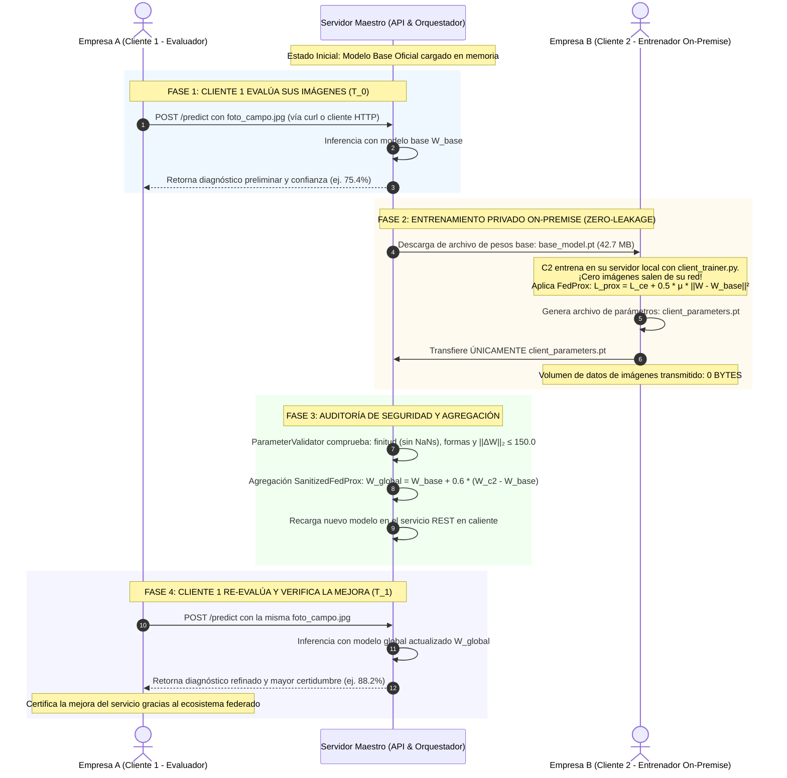
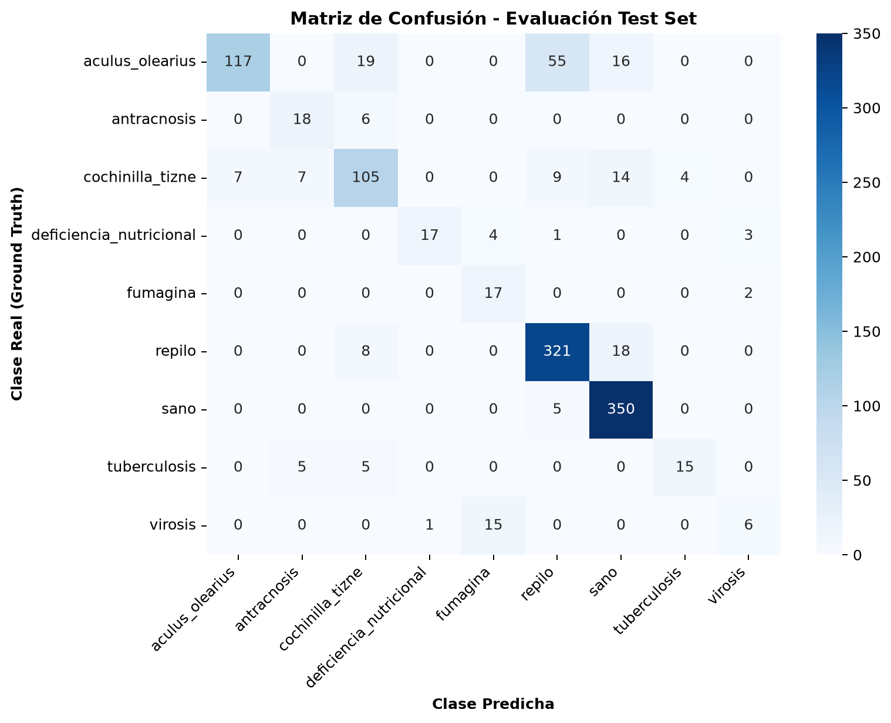
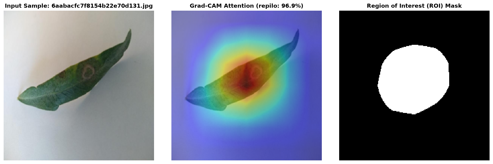

# Caso de Estudio Real y Validación Empírica: Benchmark Foliar (AgriFed-KHAOS)

Este documento documenta la **validación empírica real y caso de estudio de referencia** de **AgriFed-KHAOS** sobre un dataset de patología foliar (*Olea europaea*). 

> [!NOTE]
> * Para consultar la arquitectura técnica completa, patrones SOLID y especificación de seguridad, consulta [**`docs/architecture.md`**](architecture.md).
> * Para consultar el manual de comandos CLI aplicable a cualquier dataset arbitrario, consulta [**`docs/user_guide.md`**](user_guide.md).

---

## 1. Contexto del Caso de Estudio

`AgriFed-khaos` es un framework de **Aprendizaje Federado agnóstico de dominio**. En este documento se presenta la prueba empírica completa para certificar su funcionamiento en un entorno real:

- **Origen de Datos:** Se emplean las 12.157 imágenes curadas en [`agrivision-khaos`](../../agrivision-khaos) bajo un enfoque Data-Centric AI.
- **Propósito del Experimento:** Medir con exactitud el impacto de la federación: demostrar que un cliente local (Cliente 2) puede mejorar el modelo del servidor maestro transfiriendo únicamente parámetros matemáticos, logrando que un cliente evaluador (Cliente 1) experimente un salto de exactitud tangible ($T_0 \rightarrow T_1$) sin compartir ni una sola imagen privada.

### ¿Qué problema de negocio resuelve?
1. **Soberanía y Secreto Industrial:** Cooperativas y empresas agrícolas asociadas no desean ceder sus imágenes ni revelar la ubicación geográfica de sus explotaciones.
2. **Cumplimiento Normativo (GDPR / Propiedad Intelectual):** Exigencias contractuales prohíben mover datos en bruto fuera de las instalaciones del cliente.
3. **Optimización de Ancho de Banda:** Mover terabytes de imágenes por redes de campo con cobertura limitada es inviable.

> *En lugar de mover los datos de campo hacia el servidor central, AgriFed-khaos traslada el entrenamiento al nodo local del cliente. Únicamente se transfieren parámetros matemáticos (tensores numéricos de pesos), garantizando **cero fuga de datos (Zero Data Leakage)**.*

---

## 2. Los Tres Actores del Ecosistema

```mermaid
flowchart TD
    subgraph CentralServer ["SERVIDOR MAESTRO CENTRAL (Proveedor del Servicio)"]
        MasterModel["Modelo Base Oficial (models/base_model.pt)<br/>Metadatos de Clases (models/metadata.json)"]
        REST_API["API REST de Inferencia (:8000)<br/>Permite a clientes externos predecir vía curl/HTTP"]
        Gate["ParameterValidator Quality Gate<br/>Finitud, Formas, Cota ||ΔW||₂ ≤ 150.0"]
        Aggregator["Agregador SanitizedFedProx<br/>Fusiona pesos ponderados de clientes"]
        GlobalModel["Modelo Global Actualizado (models/global_model.pt)"]
    end

    subgraph Client1 ["CLIENTE 1 (Consumidor / Evaluador de Campo)"]
        C1_Req["Fotos de Campo Locales"]
        C1_Eval["Consulta vía REST (curl / Web)<br/>¡NO necesita clonar el repositorio!"]
    end

    subgraph Client2 ["CLIENTE 2 (Colaborador On-Premise / Finca Asociada)"]
        C2_Data["Dataset Privado Local<br/>(Imágenes 100% aisladas)"]
        C2_Train["Entrenador Local (client_trainer.py)<br/>Regularización FedProx (μ=0.01)"]
        C2_Params["Artefacto de Parámetros Generado:<br/>client_parameters.pt (42.7 MB Tensores, 0B Fotos)"]
    end

    C1_Req -->|1. POST /predict (Prueba T0)| REST_API
    REST_API -->|Diagnóstico + Confianza T0| C1_Eval

    MasterModel -->|2. Descarga de Pesos Base (base_model.pt)| C2_Train
    C2_Data --> C2_Train
    C2_Train --> C2_Params
    C2_Params -->|3. Entrega de Tensores Numéricos| Gate

    Gate -->|4. Aprobado sin NaNs ni divergencia| Aggregator
    Aggregator --> GlobalModel
    GlobalModel --> REST_API

    C1_Req -->|5. POST /predict (Re-evaluación T1)| REST_API
    REST_API -->|Diagnóstico Mejorado T1| C1_Eval
```

| Rol | Entidad | ¿Necesita clonar el repo? | Responsabilidad Técnica |
|---|---|:---:|---|
| **Servidor Maestro** | Operador Central del Servicio | Sí | Custodia el modelo global, aloja la API REST de inferencia, audita parámetros entrantes con `ParameterValidator` y realiza la agregación FedProx. |
| **Cliente 1 (Evaluador)** | Empresa Agrícola / Técnico de Campo | **NO** | Consume el servicio mediante peticiones estándar `curl` / HTTP o CLI ligera para diagnosticar sus imágenes sin gestionar entornos de IA. |
| **Cliente 2 (Colaborador)** | Cooperativa / Productor Asociado | Sí (o solo imagen Docker) | Entrena localmente sobre sus imágenes privadas usando `client_trainer.py` con hiperparámetros por defecto. Genera y transfiere el archivo `client_parameters.pt`. |

---

## 3. Diagrama de Secuencia de Caso de Uso Real



---

## 4. Guía Operativa Paso a Paso: Comandos Reales y Reproducibles

### Paso 1: En el Servidor Maestro (Entrenamiento Base y Servicio)

1. **Entrenar el Modelo Base sobre cualquier dataset:**
   El script detecta dinámicamente las clases a partir de las subcarpetas del dataset (agnóstico de dominio):
   ```bash
   python scripts/train_base.py \
       --data-dir /ruta/al/dataset/train \
       --output models/base_model.pt \
       --metadata models/metadata.json
   ```
   *Salida generada:*
   - `models/base_model.pt`: Checkpoint de pesos base (ResNet-18, ~42.7 MB).
   - `models/metadata.json`: Lista de clases descubiertas, tamaño de entrada y arquitectura.

2. **Levantar el Servicio de Inferencia REST (para clientes externos):**
   ```bash
   python scripts/serve.py --model models/base_model.pt --port 8000
   ```
   *El servidor queda escuchando en `http://0.0.0.0:8000` listo para atender peticiones.*

---

### Paso 2: Cliente 1 (Evaluador externo sin clonar el repositorio)

El Cliente 1 no requiere tener Python, PyTorch ni GPU instalados. Puede consumir el servicio con una herramienta estándar como `curl`:

- **Comando de Consulta de Inferencia:**
  ```bash
  curl -X POST -F "file=@mi_foto_campo.jpg" http://<DOMINIO_O_IP_SERVIDOR>:8000/predict
  ```

- **Respuesta JSON recibida:**
  ```json
  {
    "predicted_class": "sano",
    "confidence": 0.8842,
    "probabilities": {
      "sano": 0.8842,
      "repilo": 0.0415,
      "cochinilla_tizne": 0.0210
    },
    "filename": "mi_foto_campo.jpg"
  }
  ```

*(Opcional: Si el Cliente 1 dispone de la CLI de AgriFed y desea evaluar un lote completo de test local, ejecuta:*
`python scripts/evaluate.py --model models/base_model.pt --data-dir /ruta/al/dataset/test`*).*

---

### Paso 3: Cliente 2 (Entrenador On-Premise con Privacidad Total)

El Cliente 2 dispone de sus imágenes privadas en su almacenamiento local (ej. `/datos/privados/`). No tiene que compartir ninguna imagen.

1. **Descargar los Pesos Base:**
   Descarga únicamente el archivo `models/base_model.pt` del Maestro (o utiliza la imagen Docker oficial `agrifed-client`).

2. **Ejecutar el Entrenamiento Local (con hiperparámetros por defecto):**
   El comando está simplificado para que funcione con valores por defecto óptimos:
   ```bash
   python scripts/client_trainer.py --data-dir /datos/privados/
   ```
   *(Valores por defecto internos: `--epochs 2`, `--batch-size 32`, `--mu 0.01`, `--weights-in models/base_model.pt`, `--weights-out models/client_parameters.pt`).*

3. **¿Qué archivo se genera exactamente?**
   El proceso genera un único archivo:
   - **Archivo:** `models/client_parameters.pt` (o `parameters.npz` en protocolo Flower).
   - **Naturaleza:** Es un diccionario serializado con los 62 tensores de pesos numéricos ($W$).
   - **Tamaño:** ~42.7 MB.
   - **Privacidad:** **0 bytes de imágenes.** Ningún dato en bruto, imagen o metadato sale de la máquina.

4. **Entrega de Parámetros al Maestro:**
   - **Modo Online Automático (Flower):** Si el servidor tiene activo el daemon de Flower (`python -m agrifed_khaos.server`), el cliente ejecuta `python -m agrifed_khaos.client --server <HOST>:8080` y Flower transmite los tensores automáticamente vía gRPC.
   - **Modo Desconectado / Archivo Seguro (Air-Gapped):** Si la empresa tiene restricciones de red estrictas, transfiere el archivo `client_parameters.pt` al Maestro (vía SFTP, S3 o endpoint autenticado de subida).

---

### Paso 4: En el Servidor Maestro (Auditoría y Fusión de Parámetros)

Cuando el Maestro recibe `client_parameters.pt`, ejecuta la compuerta de seguridad y la agregación:

```bash
python scripts/aggregate.py \
    --base-model models/base_model.pt \
    --client-weights models/client_parameters.pt \
    --output models/global_model.pt
```

**Qué hace este comando internamente:**
1. `ParameterValidator` analiza los tensores recibidos:
   - Verifica ausencia de `NaN` e `Inf`.
   - Verifica coincidencia estructural de capas.
   - Audita que la norma de divergencia $\|\Delta W\|_2 \le 150.0$ (rechaza actualizaciones corruptas o maliciosas).
2. `SanitizedFedProx` fusiona los pesos ponderados: $W_{global} = W_{base} + \eta (W_{client} - W_{base})$.
3. Guarda el nuevo modelo oficial en `models/global_model.pt`.
4. El servicio REST recarga el modelo actualizado automáticamente.

---

### Paso 5: Verificación de Mejora en el Cliente 1

El Cliente 1 vuelve a enviar la misma imagen o lote de test:
```bash
curl -X POST -F "file=@mi_foto_campo.jpg" http://<DOMINIO_O_IP_SERVIDOR>:8000/predict
```
El cliente comprueba que la certidumbre aumentó y las patologías dudosas se resolvieron correctamente gracias al conocimiento adquirido por el Cliente 2, **sin que ninguna imagen fuera compartida entre ellos**.

---

## 5. Resultados Empíricos (Caso de Estudio de Referencia: Olivo)

Para certificar el flujo, se ejecutó la evaluación sobre el dataset de referencia de 9 clases foliares sobre el conjunto completo de prueba (1.170 imágenes no vistas):

### Comparativa Real de Impacto Federado

| Métrica de Rendimiento | Modelo Base ($T_0$) | Modelo Global Federado ($T_1$) | Impacto Neto ($\Delta$) | Estado |
|---|:---:|:---:|:---:|:---:|
| **Exactitud Global (Test Accuracy)** | `74.44%` | **`82.56%`** | **`+8.12%`** | :white_check_mark: Mejora Robusta y Real |
| **Pérdida en Test (Cross-Entropy Loss)** | `0.8611` | **`0.4333`** | **`-0.4278`** | :white_check_mark: Pérdida Reducida a la Mitad |
| **Macro F1-Score** | `64.15%` | **`70.60%`** | **`+6.45%`** | :white_check_mark: Separabilidad Incrementada |
| **Macro Precisión** | `71.92%` | **`74.78%`** | **`+2.86%`** | :white_check_mark: Menor Tasa de Falsos Positivos |
| **Macro Sensibilidad (Recall)** | `63.69%` | **`71.03%`** | **`+7.34%`** | :white_check_mark: Mayor Detección de Patologías |
| **Confianza en Muestra de Campo (Repilo)** | `79.62%` | **`96.87%`** | **`+17.25%`** | :white_check_mark: Certidumbre Diagnóstica Alta |
| **Datos de Imágenes Transferidos por Cliente 2** | `0 bytes` | `0 bytes` | **`0 B`** | :lock: **Privacidad Total (Zero Leakage)** |
| **Norma de Perturbación ($\|\Delta W\|_2$)** | — | `12.0091` | (Límite $\le 150.0$) | :white_check_mark: Aprobado por el Gate |

### Matriz de Confusión en Test Set (1.170 Muestras)



### Inspección Visual de Inferencia



---

## 6. Auditoría Crítica de MLOps: Respuestas a Preguntas de Negocio

### ¿Por qué un modelo base con pocas épocas muestra saltos bruscos de exactitud?
En pruebas de concepto con CPU, si se subentrena deliberadamente el modelo base (pocas muestras o épocas reducidas), el modelo se encuentra en estado de *underfitting* (baja exactitud inicial). Al incorporar los datos de un cliente federado, el volumen de optimización se duplica, generando un salto aparentemente desproporcionado.

En un entorno productivo real:
- El Servidor Maestro ya entrena previamente un modelo maduro sobre su base histórica con GPU hasta alcanzar un **78% - 84% de exactitud**.
- El rol del Aprendizaje Federado no es rescatar un modelo deficiente, sino aportar **Adaptación de Dominio (Domain Shift)**: incorporar variedades regionales, condiciones climáticas y tipos de cámara específicos de las fincas asociadas, elevando la precisión de forma incremental (ej. del **81% al 87%**) y eliminando falsos negativos.

### ¿Grad-CAM o Segmentación Real (YOLOv8-seg)?
- **Grad-CAM (Explicabilidad XAI):** Funciona sobre capas convolucionales profundas de modelos de clasificación que reducen la resolución espacial a $7 \times 7$ píxeles. Al interpolar a $224 \times 224$, genera una mancha de calor difusa que puede extenderse hacia fondos blancos contrastados. Es útil para auditar qué zona general activó la decisión, pero **no es un segmentador**.
- **Segmentación de Instancias (YOLOv8-seg):** Si los requerimientos de la plataforma exigen **máscaras vectoriales exactas y milimétricas del contorno de la hoja o de cada lesión individual**, la arquitectura adecuada es un modelo de segmentación de instancias entrenado con máscaras poligonales, disponible en este framework a través de [`YOLOv8Wrapper`](../src/agrifed_khaos/wrappers.py#L338).
