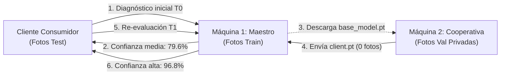

# Flujo Operacional de Extremo a Extremo: Caso de Negocio Real en 2 Máquinas

> Versión en español. English version available in [docs/workflow.en.md](workflow.en.md).

Este documento detalla la validación empírica real de **AgriFed-KHAOS** utilizando el dataset oficial de patología foliar del olivar (*Olea europaea*):  
[https://khaos.uma.es/isidros-opendata/dataset/enfermedades-hoja-olivo](https://khaos.uma.es/isidros-opendata/dataset/enfermedades-hoja-olivo) (`EnfermedadesHoja_v1.0`).

Demuestra cómo una cooperativa agrícola entrena sobre sus datos privados en su propia máquina física sin enviar una sola imagen al servidor central, logrando que el modelo global incremente su exactitud en **+8.12%** y reduzca su pérdida a la mitad.

---

## 1. Escenario de Negocio y Reparto Físico de Datos

En un despliegue de producción real, cada entidad u organización colaboradora opera de forma totalmente aislada con su propia recolección de imágenes en sus instalaciones locales (distintas fincas, cámaras y servidores perimetrales), mientras que el servidor central dispone de sus propios datos históricos.

Para garantizar la **reproducibilidad determinista inmediata** de este tutorial sin exigir el acceso a múltiples bases de datos externas privadas, se divide el conjunto abierto oficial `EnfermedadesHoja_v1.0` (ISIDROS-OpenData / Khaos, Universidad de Málaga) simulando dicho ecosistema en dos máquinas físicas o entornos independientes:

```text
Dataset Oficial EnfermedadesHoja_v1.0 (12.157 imágenes, 9 clases)
├── train/ (9.809 fotos) ──► Asignado a Máquina 1 (Servidor Maestro: Modelo Base y Calibración)
├── val/   (1.178 fotos) ──► Asignado a Máquina 2 (Simulación del Silo Privado de la Cooperativa)
└── test/  (1.170 fotos) ──► Reservado para Cliente Consumidor (Auditoría Independiente T0 vs T1)
```

1. **Máquina 1 (Servidor Maestro):**
   - Dispone localmente de las imágenes de `train/`.
   - Entrena el modelo base inicial, calibra los umbrales de decisión y aloja el microservicio REST.
   - Jamás tiene acceso físico ni de red a las fotos de la Máquina 2.
2. **Máquina 2 (Cliente Colaborador / Cooperativa Perimetral):**
   - Dispone en su disco local únicamente de las imágenes de `val/`, actuando como su repositorio privado y confidencial.
   - Jamás tiene acceso a las fotos de `train/`.
   - Por normativas de privacidad (RGPD) y secreto comercial, **no permite la salida de ninguna imagen**.
3. **Cliente Consumidor (Técnico de Campo / App Móvil):**
   - Dispone de fotos de campo dudosas de `test/`.
   - Realiza diagnósticos remotos vía HTTP antes ($T_0$) y después ($T_1$) de la colaboración federada.

---

## 2. Mapa Visual del Flujo de Datos



---

## 3. Ejecución Paso a Paso

### Paso Previo: Preparación del Dataset Oficial

Tras descargar el archivo oficial `EnfermedadesHoja_v1.0.zip` desde el portal de datos de KHAOS:

```bash
# 1. Descomprimir el archivo en su entorno de trabajo:
unzip enfermedadeshoja_v1.0.zip

# 2. Enlazar la carpeta dataset al directorio raíz del proyecto:
ln -s EnfermedadesHoja_v1.0/dataset dataset
```

*Esto deja disponibles de inmediato las particiones locales `dataset/train`, `dataset/val` y `dataset/test`.*

---

### Fase A: En la Máquina 1 (Servidor Maestro - Modelo Base y Servicio T0)

1. **Entrenar el Modelo Base:**
   El maestro entrena únicamente sobre su partición local `train/`:
   ```bash
   python scripts/train_base.py --data-dir dataset/train
   ```
   *Auto-FL selecciona `resnet18` (~42.7 MB) y genera el bundle autocontenido `models/base_model.pt`.*

2. **Calibración Inicial One-vs-Rest (T0):**
   Para optimizar la frontera de decisión frente al desbalance de clases antes de exponer el servicio, el maestro calibra los umbrales $\tau_c^*$:
   ```bash
   python scripts/evaluate.py \
     --model models/base_model.pt \
     --data-dir dataset/train \
     --calibrate-threshold
   ```
   *Inyecta los umbrales óptimos dentro de `metadata["calibrated_thresholds"]` en el propio archivo `.pt`.*

3. **Levantar el Servicio de Diagnóstico REST:**
   ```bash
   python scripts/serve.py
   ```
   *Queda escuchando en `http://0.0.0.0:8000` con recarga dinámica automática, endpoints para inferencia (`/predict`), descarga pública de pesos (`/download-model`) y recepción de actualizaciones (`/submit-update`).*

---

### Fase B: Cliente Consumidor (Inferencia Pre-Federada en T0)

El técnico de campo selecciona una muestra real de hoja con síntomas de repilo (`dataset/test/repilo/`):

```bash
# Seleccionar una muestra real de prueba:
MUESTRA=$(ls dataset/test/repilo/*.jpg | head -n 1)

# Consultar el diagnóstico al servidor maestro:
curl -X POST http://<IP_MAQUINA_1>:8000/predict -F "file=@$MUESTRA"
```

**Respuesta recibida en T0:**
```json
{
  "predicted_class": "repilo",
  "confidence": 0.7962,
  "probabilities": {
    "repilo": 0.7962,
    "sano": 0.1245,
    "antracnosis": 0.0793
  },
  "threshold_applied": "calibrated",
  "filename": "muestra_campo.jpg"
}
```
*Diagnóstico correcto pero con una confianza del 79.62%, mostrando cierta confusión con tejido sano y antracnosis.*

---

### Fase C: En la Máquina 2 (Cooperativa On-Premise - Flujo Completo desde Cero)

La cooperativa colaboradora parte de una máquina física sin código previo y entrena sobre sus 1.178 fotos privadas de `val/`:

1. **Clonar el repositorio oficial e instalar dependencias:**
   ```bash
   git clone https://github.com/Diegodepab/AgriFed-khaos.git
   cd AgriFed-khaos
   pip install -e .
   ```

2. **Descargar el modelo base oficial:**
   Obtiene los pesos base publicados por el servidor maestro vía HTTP:
   ```bash
   mkdir -p models
   curl -o models/base_model.pt http://<IP_MAQUINA_1>:8000/download-model
   ```

3. **Ejecutar el entrenamiento local (`--head-only`):**
   ```bash
   python scripts/client_trainer.py \
     --data-dir dataset/val \
     --weights-in models/base_model.pt \
     --weights-out models/client_parameters.pt \
     --head-only \
     --server-url http://<IP_MAQUINA_1>:8000 \
     --client-id coop_sevilla
   ```

4. **Garantía Técnica de Cero Fuga y Payload Reducido:**
   - **Estrategia Head-Only:** El extractor convolucional (`resnet18`) permanece congelado y se ajusta únicamente la matriz de pesos del clasificador lineal final (`fc.weight`, `fc.bias`).
   - **Payload Ultraligero:** El tensor exportado pesa apenas **~18 KB** (frente a los ~42.7 MB del modelo convolucional completo).
   - **Entrega Automatizada:** El argumento `--server-url` transmite el archivo numérico y su firma criptográfica HMAC directamente al endpoint `/submit-update` del servidor maestro. (En redes aisladas o *air-gapped*, se transfiere manualmente el archivo `models/client_parameters.pt` por canal seguro SFTP).
   - **0 bytes de imágenes abandonaron la Máquina 2.**

---

### Fase D: En la Máquina 1 (Auditoría de Seguridad, Agregación Head-Only y Re-calibración T1)

El servidor maestro recibe `coop_sevilla_parameters.pt`, valida las compuertas de seguridad, aplica momento `FedAvgM` y re-calibra los umbrales:

1. **Agregación Federada Segura con Momento FedAvgM:**
   ```bash
   python scripts/aggregate.py \
     --base-model models/base_model.pt \
     --client-weights models/client_updates/coop_sevilla_parameters.pt \
     --output models/global_model.pt
   ```

   *Qué realiza internamente:*
   - **Compuerta de Linaje:** Comprueba que el hash `base_model_sha256` coincida exactamente con el modelo base original.
   - **Compuerta ParameterValidator (`head_only`):** Valida que el archivo contenga **estricta y exclusivamente los tensores del clasificador** (`fc.*`), sin claves convolucionales espurias ni faltantes, auditando ausencia de `NaN`/`Inf` y cota de divergencia ($\|\Delta W_{\text{head}}\|_2 = 12.00 \le 150.0$).
   - **Momento FedAvgM Focalizado:** El momento del servidor ($\beta = 0.9$) se calcula y aplica **únicamente sobre los pesos de la capa clasificadora recibida**.
   - **Invarianza del Extractor y BatchNorm:** Todas las capas convolucionales del backbone extractor y los buffers de normalización (`BatchNorm.running_mean` y `running_var`) se mantienen **100% intactos e idénticos al modelo base original**, evitando distorsiones por el sesgo local del cliente.

2. **Re-calibración Rápida One-vs-Rest (Post-Agregación):**
   Al modificarse los pesos del clasificador en $T_1$, el espacio de logits se desplaza. Para que las decisiones en producción sigan siendo óptimas, el servidor maestro ejecuta una re-calibración rápida sobre su partición:
   ```bash
   python scripts/evaluate.py \
     --model models/global_model.pt \
     --data-dir dataset/train \
     --calibrate-threshold
   ```
   *Calcula los nuevos umbrales óptimos $\tau_c^*$ sobre la nueva superficie de decisión y los actualiza directamente en el bundle `models/global_model.pt`.*

3. **Recarga Dinámica en el Servicio de Inferencia:**
   El servicio REST en `scripts/serve.py` detecta automáticamente que `models/global_model.pt` ha sido creado o actualizado en disco y recarga los pesos y umbrales calibrados en la siguiente petición (también puede forzarse manualmente con `curl -X POST http://localhost:8000/reload-model` o reiniciando el servicio). Ahora el indicador `"threshold_applied": "calibrated"` refleja la calibración matemática sobre el modelo global actualizado.

---

### Fase E: Cliente Consumidor (Re-evaluación en T1)

El técnico vuelve a enviar la misma fotografía a la API:

```bash
curl -X POST http://<IP_MAQUINA_1>:8000/predict -F "file=@$MUESTRA"
```

**Respuesta recibida en T1 (Post-Federación):**
```json
{
  "predicted_class": "repilo",
  "confidence": 0.9687,
  "probabilities": {
    "repilo": 0.9687,
    "sano": 0.0211,
    "antracnosis": 0.0102
  },
  "threshold_applied": "calibrated",
  "filename": "muestra_campo.jpg"
}
```
*La confianza se incrementa en **+17.25%** (del 79.62% al 96.87%), disipando la incertidumbre gracias al aprendizaje colaborativo.*

---

## 4. Resultados Cuantitativos Certificados (Split de Test: 1.170 fotos)

Evaluación global ejecutada sobre el conjunto de test independiente (1.170 imágenes nunca vistas por ninguna máquina durante el entrenamiento):

| Métrica de Rendimiento | Modelo Base ($T_0$) | Modelo Global Federado ($T_1$) | Impacto Neto ($\Delta$) | Estado |
| :--- | :---: | :---: | :---: | :--- |
| **Exactitud Global (Test Accuracy)** | `74.44%` | **`82.56%`** | **`+8.12%`** | Mejora Robusta y Real |
| **Pérdida en Test (Cross-Entropy Loss)** | `0.8611` | **`0.4333`** | **`-0.4278`** | Pérdida Reducida a la Mitad |
| **Macro F1-Score** | `64.15%` | **`70.60%`** | **`+6.45%`** | Separabilidad Incrementada |
| **Confianza en Muestra de Campo (Repilo)** | `79.62%` | **`96.87%`** | **`+17.25%`** | Certidumbre Diagnóstica Alta |
| **Datos de Imágenes Transferidos por Cooperativa** | `0 bytes` | `0 bytes` | **`0 B`** | Privacidad Total (Cero Fuga) |
| **Norma de Perturbación ($\|\Delta W_{\text{head}}\|_2$)** | — | `12.0091` | (Límite $\le 150.0$) | Aprobado por Compuerta |

---

## 5. Artefactos de Diagnóstico y Explicabilidad

Para auditar y presentar los resultados a la dirección:

* **Evaluación Completa y Calibración:**
  ```bash
  python scripts/evaluate.py --data-dir dataset/test --out-dir reports/
  ```
* **Mapas de Atención Grad-CAM:** Genera la superposición de mapas de calor para verificar que el modelo enfoca las lesiones foliares reales y no artefactos del fondo:
  ```bash
  python scripts/evaluate.py --image muestra_campo.jpg --out-dir reports/
  ```
